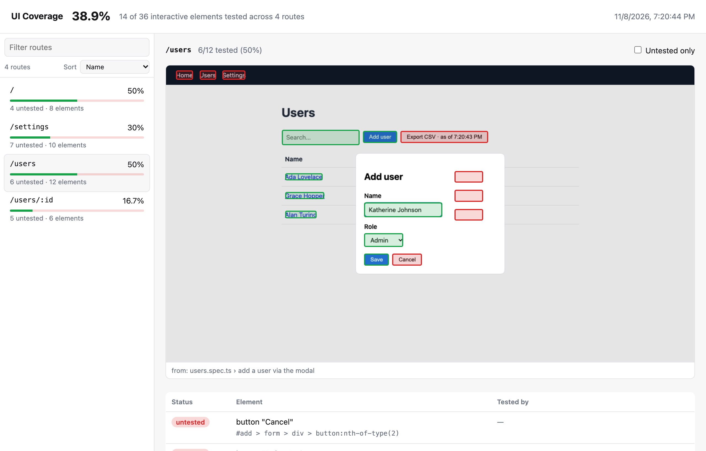
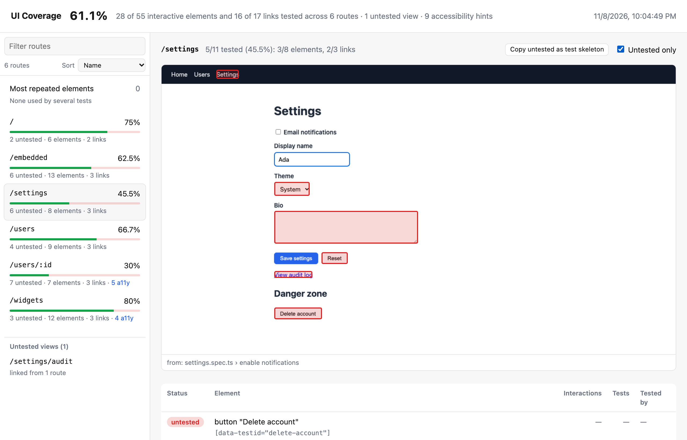
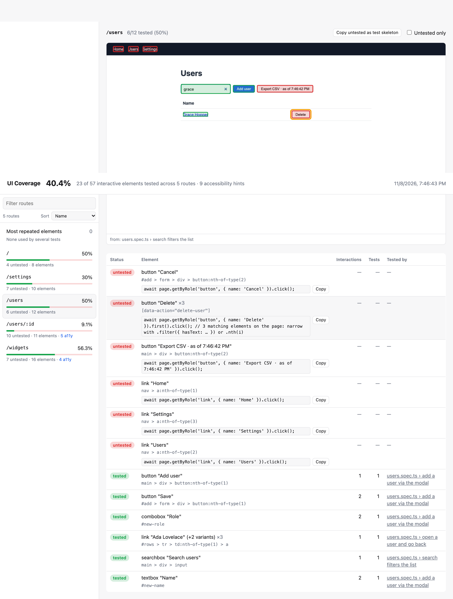
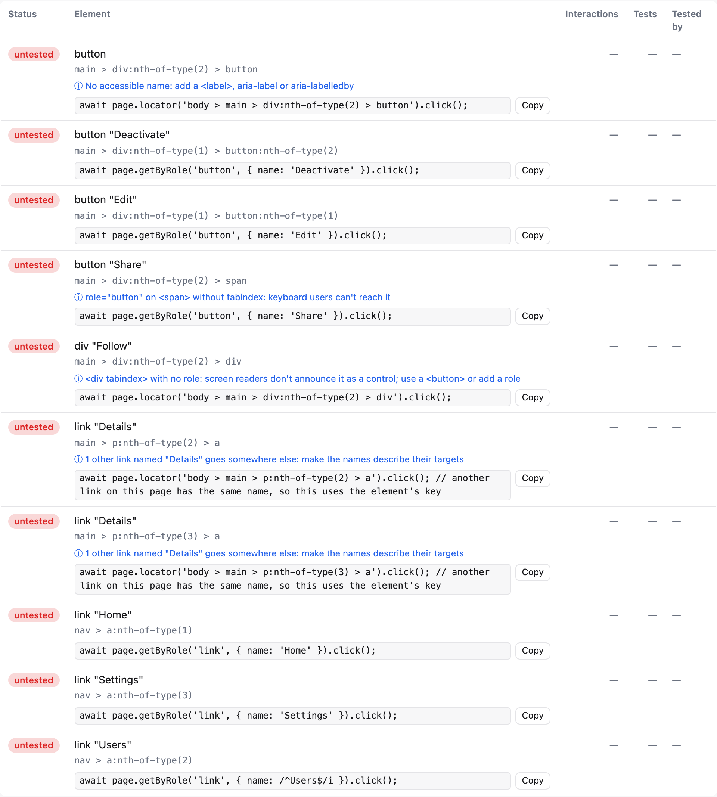
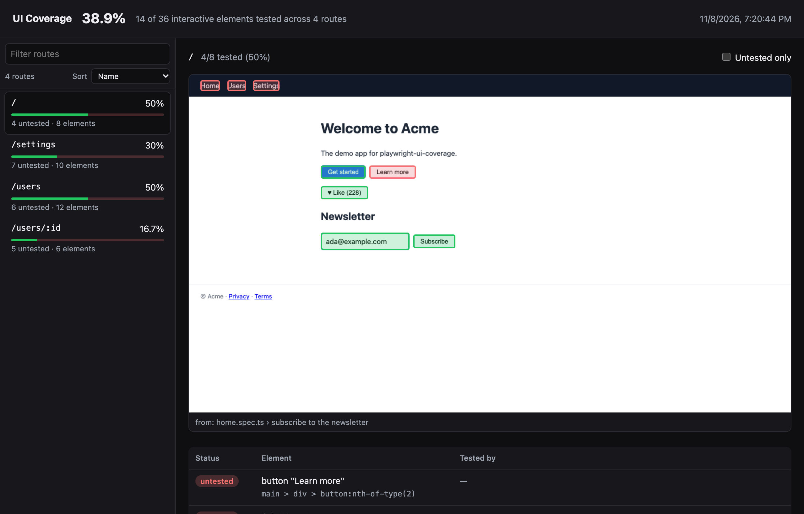
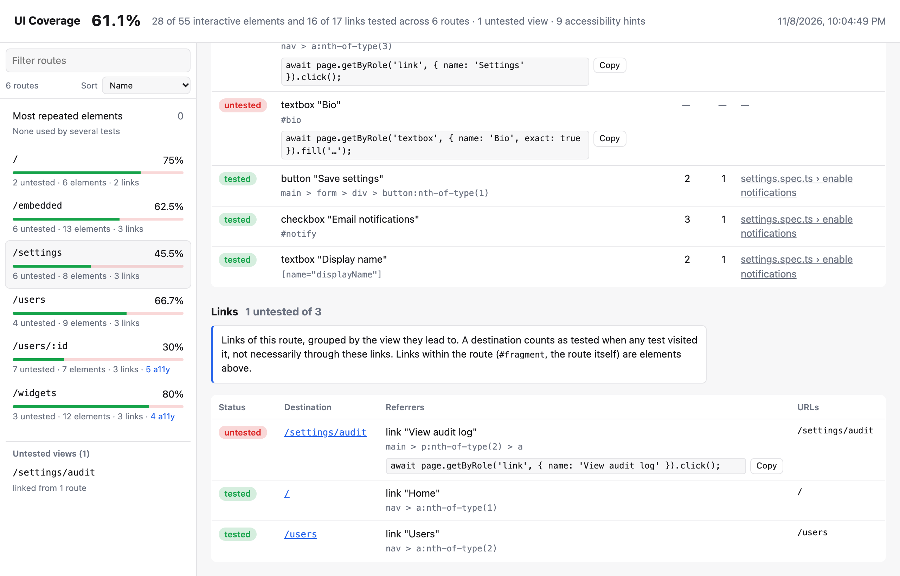

# playwright-ui-coverage

See which buttons, links and inputs your Playwright E2E tests **actually touch**, as screenshots with green (tested) and red (untested) overlays, a coverage % per page, and the tests that covered each element.

> Status: early development (0.1.0). APIs may change.



## What you get

**Every page your tests visit, with each interactive element marked.** Green means a test clicked or typed into it, red means no test did. The sidebar shows coverage per route, and dynamic segments are grouped (`/users/1`, `/users/2` → `/users/:id`).

**Find what's missing.** Turn on *Untested only* to hide everything that's already covered:



**See where each element is, and which tests cover it.** Hover a row to highlight that element on the screenshot. Repeated elements such as a "Delete" button on every row are grouped into one entry:



**Jump to the test and its trace.** With Playwright's HTML reporter configured, each test under "Tested by" links to its entry in the HTML report, and to its trace when one was recorded. See [Links to the HTML report and traces](#links-to-the-html-report-and-traces).

**Spot repeated setup.** The element table shows how many times each element was used (**Interactions**) and by how many tests (**Tests**); click either header to sort by it. **Most repeated elements** in the sidebar lists the elements used by the most tests across the report, such as a login form that every test fills in first.

**Write the missing tests faster.** Each untested element has a ready-to-paste Playwright line with a *Copy* button, and *Copy untested as test skeleton* gives you a whole test for the route. Click an element's box on the screenshot to jump to its row. Elements also get small, informational **accessibility hints** (no accessible name, links with the same name going to different places, controls keyboard users can't reach):



**Large suites.** Filter routes by name (press `/`), sort them by name, lowest coverage or most untested elements, and screenshots load lazily. A synthetic report with 300 routes × 80 elements opens in about 0.1 s and switching routes takes a few milliseconds (`npm run perf` to measure).

**Dark mode** follows your system setting:



## Quick start

```bash
npm i -D playwright-ui-coverage
```

There are two ways to turn recording on. Both use the same reporter and produce the same results.

### Option A: config only (experimental, no test changes)

```ts
// playwright.config.ts
import { defineConfig } from '@playwright/test';
import 'playwright-ui-coverage/register'; // ← records every browser context in every test

export default defineConfig({
  reporter: [
    ['list'],
    ['playwright-ui-coverage/reporter'], // options: see Configuration
  ],
});
```

This is the quickest way to try it on an existing suite. It hooks into Playwright's internal instrumentation, the same hook Playwright's trace recorder uses. That API is private, so if a Playwright release changes it, register mode switches itself off with a warning (set `UICOV_STRICT=1` to make that an error, e.g. in CI). Option B keeps working either way.

### Option B: fixture (stable, recommended for long-term use)

Merge `uiCoverage` into your own fixtures with Playwright's `mergeTests`:

```ts
// tests/fixtures.ts
import { mergeTests } from '@playwright/test';
import { uiCoverage } from 'playwright-ui-coverage';
import { test as appTest } from './my-fixtures';

export const test = mergeTests(appTest, uiCoverage);
export { expect } from '@playwright/test';
```

No fixtures of your own? Import `test` directly instead: `import { test, expect } from 'playwright-ui-coverage'`.

Then add the reporter the same way as in Option A.

Either way, recording covers every page and popup in the test's browser context. It adds **no steps** to your HTML report or trace, because its calls are marked as internal.

**3. Run your tests** and open `ui-coverage-report/index.html`.

```
UI coverage: 57.3% (51/89: 33/70 elements, 18/19 links)
  /              75%  6/8
  /embedded    62.5%  10/16
  /long        41.2%  7/17
  /settings    45.5%  5/11
  /users       66.7%  8/12
  /users/:id     30%  3/10
  /widgets       80%  12/15
  1 untested view(s), only linked to: /settings/audit
  9 accessibility hint(s), informational (see the report)
```

Coverage counts **units**: interactive elements plus [links](#links-and-untested-views), grouped by the view they lead to. In the demo, every view but `/settings/audit` is visited by some test, so 18 of the 19 link units are tested; the "View audit log" link on `/settings` is the untested one, and `/settings/audit` is listed as an untested view.

## How it works

1. **Tracker** (`addInitScript`): capture-phase listeners record every interaction (`click`, `input`, `change`, `submit`, `dblclick`, `contextmenu`, keyboard activation, drag and drop, opt-in `scroll`/`focus`/`blur`, see [Interaction types](#interaction-types)) on an [interactive element](#which-elements-count), whichever Playwright API (or a real user) caused it.
2. **Inventory + screenshot**: when a page loads and shortly after interactions, the recorder lists every visible interactive element (with bounding boxes) and takes a full-page screenshot. It only takes a new screenshot when new elements appear. When an interaction makes new elements appear (a modal opens), the page sends an inventory as soon as its handlers have run, and the recorder takes a viewport screenshot right away, so states a test closes again within a few milliseconds get a screenshot too (`captureTransientStates`). It records **raw facts** (tag, attributes, position among siblings, ancestors, accessible name), not keys: identity and filtering are decided later. Recording runs while the test keeps going. In Chromium, a full-page screenshot of a page larger than the viewport briefly resizes the viewport, and input sent during it can get lost (a mouse wheel that doesn't scroll, a click in a cross-origin iframe that never arrives). So there, a full-page capture waits until the test's input call in progress (click, fill, hover, `mouse.wheel`, …) is done, and the next input call waits until the capture is done. That's usually tens of milliseconds, and doesn't change the test's steps.
3. **Reporter**: merges data from all workers, applies the [report-time rules](#report-time-rules) (filters, identity), groups by route (`/users/42` → `/users/:id`), marks an element *tested* if any test interacted with it and a link *tested* if any test visited the view it leads to, and renders the HTML report and `coverage.json`. It also saves the raw data in `ui-coverage-report/data/`, so you can [rebuild the report](#rebuilding-the-report-report-cli) with other rules without running the tests again.

### Which elements count

An element counts if it is visible in at least one inventory and one of these applies:

- **Interactive HTML** ([WHATWG interactive content](https://html.spec.whatwg.org/multipage/dom.html#interactive-content)): `a[href]`, `button`, `input` (not `type=hidden`), `select`, `textarea`, `<summary>` of a `<details>`, `audio`/`video` with `controls`, and contenteditable editing hosts.
- **ARIA widget roles**: `button`, `checkbox`, `combobox`, `link`, `listbox`, `menuitem`, `menuitemcheckbox`, `menuitemradio`, `option`, `radio`, `scrollbar`, `searchbox`, `slider`, `spinbutton`, `switch`, `tab`, `textbox`, `treeitem`. Composite containers (`menu`, `tablist`, `tree`, `grid`, …) don't count themselves; their items do.
- **`tabindex` ≥ 0** (e.g. a clickable `<div class="card" tabindex="0">`). `tabindex="-1"` alone doesn't count.
- **`draggable="true"`**.
- **Scroll containers** (`overflow: auto|scroll` with content that overflows), when `scroll` interactions are recorded. They only receive `scroll` credit; a click on text inside a scrollable panel doesn't mark the panel tested.

Never counted:

- `<a href="tel:…">`, `mailto:` and `sms:` links: they hand off to another app.
- `<label>`: clicking a label activates its control, and the control is what gets credited (once, the browser forwards the click). Other events on a label (`dblclick`, `contextmenu`, …) are credited to the control too.
- `<iframe>`, `<embed>`, `<object>` themselves: their content is a separate document. The elements inside an iframe count on their own, see [Iframes and shadow DOM](#iframes-and-shadow-dom).
- `<option>` inside a `<select>` (the `select` counts), and elements inside a contenteditable editor (the editor counts).

**Nested widgets count once, as the inner ones.** A widget that contains other widgets (a `tabindex=0` card with a "Like" and a "Share" button, a `role=combobox` wrapper around an `<input>`) is not counted itself. The inner elements are the actual controls, the ones `getByRole` finds, and counting only the outer one would merge distinct controls into one element. A click on the outer element's own area credits its inner widget if it has exactly one (it's the same control), and nothing if it has several. Widgets inside a grouping role (`group`, `menu`, `listbox`, `tree`, …) are separate widgets: a tree item with a nested group of child items still counts.

**Markup overrides.** `data-uicov-interactive` on an element or an ancestor changes the rules. The closest element with a directive that applies wins:

| Value | Effect |
|---|---|
| `include` | This element counts, even if no rule says so (e.g. a `<div>` drop zone with a click handler). Also exempt from the nesting rule. |
| `exclude` | This element doesn't count (its descendants still can). |
| `exclude-all` | Nothing in this subtree counts. `data-uicov-ignore` and the deprecated `ignoreSelectors` are aliases. |
| `reset` | Stop inheriting: inside an `exclude-all` subtree, the normal rules apply again. |

### Element identity

Elements are matched across tests by **attributes and position, never by visible text**, so copy changes, translations and dynamic text (counters, user names, timestamps) don't turn one element into a new one. The first rule that applies gives the element's key:

| # | Source | Key in the report |
|---|---|---|
| 0 | an [`elements`](#named-elements) rule in the config | `Logo home link` (its `name` as-is) |
| 1 | `data-uicov-id` (explicit override, never filtered) | `checkout-submit` (the value as-is) |
| 2 | `significantAttributes` you configure, in order | `[data-component="avatar"]` |
| 3 | `data-testid`, `data-test`, `data-test-id`, `data-cy`, `data-qa`, `row-id` | `[data-testid="save"]` |
| 4 | `id` | `#email` |
| 5 | `name` (radios/checkboxes add their `value`) | `[name="plan"][value="pro"]` |
| 6 | Position: tag + index among same-tag siblings, up to the nearest ancestor that has a key from 1–5 (or `<body>`) | `#add > form > div > button:nth-of-type(2)` |

Keys are computed when the report is built, from the recorded attributes, so changing `significantAttributes` or `attributeFilters` only needs a [rebuild](#rebuilding-the-report-report-cli). Attribute values that look generated (rules 2–5) are skipped, see `attributeFilters` below. Visible text (role + accessible name, e.g. `button "Save"`) is shown in the report as the element's **label** only.

Positional keys read like CSS selectors and only use an index when there are several siblings with the same tag. Table rows (`<tr>`, `role="row"`) never get an index, so a "Delete" button on every row is one element with several instances (unless `autoGroup: { rows: false }`). Positional keys change when the markup around the element changes, so for anything that matters, add a `data-testid` (or a `data-uicov-id`).

Elements that share a key are one element. [Element grouping](#element-grouping) goes further: it merges elements with *different* keys that are really one control repeated (the "Add to cart" button of every product card), and splits elements that share a key but are different controls (the "Submit" of a login form and of a signup form).

### Element grouping

A group is one element of the view: it counts once in the score, is tested when a test interacts with any member, and is listed as `label (N instances)` in the report (`instances` and `group` in [`coverage.json`](#coveragejson)). Its members' boxes on the screenshots all point at it. The first rule that applies to an element decides:

| # | Rule | Key of the group | `group.reason` |
|---|---|---|---|
| 1 | **`data-uicov-group="name"`** on the element or an ancestor (also across frames and shadow roots; the closest one wins). Every element with the same name is one group, even a single one. An empty value (`data-uicov-group=""`) turns all grouping off for that subtree. | `[data-uicov-group="name"]` | `markup` |
| 2 | **`elementGroups`** in the config: the first entry whose selector matches the element or an ancestor. A group even with one match. `exclude: true` turns grouping off instead. | the entry's selector | `config` |
| 3 | **Form boundary**: elements that share a key but are in different forms (`<form>`, `role="form"`), or in and out of one, are one element per form. Keys only change when there's such a conflict in the view. | `#signup [data-testid="submit"]` (the form's key, a space, the key) | — |
| 4 | **Table rows**: controls in the same column/position of the rows (`<tr>`, `role="row"`) of a `<table>` or `role="grid"`/`"table"`/`"treegrid"`, whatever their own attributes (`id="edit-42"`) or names ("Edit Ada"). | the table's key, then the position with rows unindexed: `[data-testid="users"] > tbody > tr > td:nth-of-type(3) > button` | `row` |
| 5 | **Repeated structures**: elements with the same shape at the same depth: the same chain of tags and classes from the page top down (class tokens containing digits ignored), the same role and the same accessible name, and their own identity equal once digits are ignored (`data-testid="add-to-cart-1"` and `"add-to-cart-2"` match, `"profile-edit"` and `"billing-edit"` don't). Ancestor forms must have the same identity and `action`, so identical login and signup forms aren't merged. | positional, from the deepest ancestor identity all members share, with an index only where all members agree: `[data-testid="products"] > li > div > button:nth-of-type(1)` | `repeated` |
| 6 | **Labels**: a `<label>` that counts (e.g. `tabindex="0"`) is merged into its control (`for`, or the control inside it), since its events are credited to the control anyway. Not counted as an instance. | the control's key | `label` |

Elements that share a key without any of these (the same `data-testid` on every row) are reported with `group.reason: "same-key"`.

The heuristics (rules 4–6) only group **two or more** elements of the view, from all tests together (a list with one card in one test and three in another still forms one group). They are deliberately conservative:

- Links (`<a href>`) aren't grouped by rows or structure: a link to another view is already one [link unit](#links-and-untested-views) per destination view, whatever the number of links. Elements with a `data-uicov-id` (an explicit identity) aren't grouped automatically either; explicit groups (rules 1–2) apply to both.
- Repeated structures need an accessible name and the same one: navigation items ("Home", "Users") and toolbar buttons have different names, so they stay separate. Nothing inside `<nav>`, `<menu>` or `role="navigation"`/`menu`/`menubar`/`tablist`/`toolbar`/`radiogroup`/`listbox`/`tree` is grouped this way.
- Limits: two unrelated controls with identical names and markup structure (two "Edit" buttons in two identical, unnamed panels) are grouped; give one a `data-testid` with a word in it, or use `data-uicov-group=""`. Names that change per item ("Add Desk lamp to cart") prevent a repeated-structure group; use `data-uicov-group` or `elementGroups`. Group keys of rules 4–5 are positional, so they change with the markup like any positional key.

Turn the heuristics off, all or one by one, with `autoGroup` (report time, so a [rebuild](#rebuilding-the-report-report-cli) shows the effect):

```ts
// ui-coverage.config.ts
export default defineUiCoverageConfig({
  autoGroup: { repeated: false },   // or `false` for all; keys: rows, repeated, labels, forms (default: all true)
  elementGroups: [
    { selector: '.product-card', name: 'product card' },     // everything inside any card is one element
    { selector: 'button', documentScope: 'star-rating' },    // inside a shadow host or frame
    { selector: '.legacy-list li', exclude: true },          // never group these
  ],
});
```

With `rows: false`, table rows get an index in positional keys (`tr:nth-of-type(2)`), and rows are only grouped if they qualify as repeated structures.

### Iframes and shadow DOM

Elements inside **iframes** (same-origin and cross-origin) and **open shadow roots** count like any other element of the page, under the page's URL.

- **Keys** are prefixed by the key of the frame element or shadow host and ` >> `, as many times as they are nested: `iframe[data-testid="payments"] >> [data-testid="card"]`, `promo-banner >> div > button:nth-of-type(2)`, `[data-testid="payments"] >> #pay > brand-picker >> div > button`. Each part is computed in its own document or shadow tree (a positional key stops at the shadow root). A `data-uicov-id` value is still used as-is, without a prefix. Elements in a frame also list the frame elements' keys in `coverage.json` (`frames`).
- **Recording**: each frame runs its own copy of the tracker, and the recorder places the frame's elements under the frame element (`page.frames()`), with boxes mapped into the page's coordinates (frame element's content box, scroll positions), so overlays line up on the page screenshot. Elements scrolled out of their frame still count but get no box. In shadow roots, events are credited to the element they happened on (`composedPath()`), including events that don't leave the shadow root, like `change`.
- **Markup overrides** apply across shadow boundaries: `data-uicov-ignore` on a host excludes its shadow content. Across frames they apply at report time: an ignored `<iframe>` (by `data-uicov-ignore` or `ignoreSelectors`) excludes everything inside it. With [`elementFilters`](#report-time-rules), which match the element itself, exclude a frame's content with `{ selector: '*', documentScope: 'iframe#ads', include: false }`.
- **Closed shadow roots** can't be read from the page, so their content isn't recorded; the host counts if it is interactive itself (e.g. `role="button"`, `tabindex="0"`), and events inside are credited to it.
- **Suggested locators** use `page.frameLocator('<frame key>')` for elements in frames. Playwright's locators already pierce open shadow roots.

### Links and untested views

A link matters because of **where it goes**, so links are counted by destination rather than by clicks:

- **Link units.** Each `<a href>` (and `<area href>`) is resolved (against `<base>` too) and mapped to a view by the same function as page URLs ([`views`, `viewFilters`](#views), then `normalizeUrl`); links to URLs `viewFilters` exclude are dropped. The links of a view that go to the same other view are **one unit**: on `/users`, the three user rows (`/users/1`, `/users/2`, `/users/3`) are one link to `/users/:id`, and the nav "Home" link and a "Back home" button-link are one link to `/`.
- **Tested** when any counted test visited the destination view, by any path (a `goto`, a redirect, another link), not necessarily through that link. "Counted" is the same as for interactions: the last passing attempt of each test, see [Retries and failed tests](#retries-and-failed-tests).
- **No double counting.** An `<a>` that belongs to a link unit is not also an interactive element. Its clicks are still recorded (shown with the link) but don't change coverage.
- **Still elements** (tested when clicked, as before): links within the same view (`#section`, `#`, a link to the page itself or to another page of the same view, like `/users/2` on `/users/:id`), `javascript:` and empty hrefs, links inside iframes (they navigate the frame), and every link in [component tests](#component-testing). `tel:`, `mailto:` and `sms:` links never count.
- **External links** (to an origin no test visited): interactive elements by default. `links: { external: 'ignore' }` leaves them out entirely. `links: false` turns link units off: every link is an element again.
- **Untested views.** Destination views that no test visited at all appear separately: in the HTML report's sidebar ("Untested views", with the routes and links that point to them and the URLs), in `coverage.json` (`untestedViews`, with `referrers`), and in the console. Each view's page in the report has a **Links** table: destination view, *Referrers* (the `<a>` elements, with a suggested `page.getByRole('link', { name })…click()` line for untested ones) and *URLs*.



```ts
// ui-coverage.config.ts
export default defineUiCoverageConfig({
  links: { external: 'ignore' },  // default: {} (external links are elements); false: no link units
});
```

**Denominator:** coverage is (tested elements + tested link units) / (elements + link units), overall and per view, and that is what thresholds, the baseline and `compare` use. Compared with counting `<a>` elements by clicks, it usually goes up (navigation is commonly covered by visiting pages) and a view's numbers include its outgoing links. A baseline written before link units lists `<a>` elements as untested elements: they show as resolved (`removed`) and the link units as new gaps, so run `baseline update` once after upgrading.

## Configuration

All settings live in one file, `ui-coverage.config.ts` next to `playwright.config.ts`. The recorder (in both modes), the reporter and the [`report` CLI](#rebuilding-the-report-report-cli) all read it:

```ts
// ui-coverage.config.ts
import { DEFAULT_INTERACTIONS, defineUiCoverageConfig } from 'playwright-ui-coverage';

export default defineUiCoverageConfig({
  // Report-time rules: change them and rebuild the report without running tests.
  elementFilters: [{ selector: '.cookie-banner *', include: false }],
  elements: [{ selector: '#main-nav [href="/"]', name: 'Logo home link' }],
  significantAttributes: ['data-component'],
  attributeFilters: [{ attribute: 'id', value: 'tmp-.*', comment: 'ids from the legacy form builder' }],

  // Views: which URLs are one page in the report, and which aren't part of it.
  views: ['/users/:username', { pattern: '/docs/:section/*', groupBy: ['section'] }],
  viewFilters: [{ pattern: 'https://auth.example.com/*', include: false }],

  // Reporter settings.
  outputFolder: 'ui-coverage-report',
  threshold: { overall: 60 },

  // Recording options: what the tests capture while they run.
  recording: {
    screenshots: 'first-only',
    interactions: [...DEFAULT_INTERACTIONS, 'focus'],
  },

  // Named overrides, e.g. a stricter config for PR runs.
  profiles: [
    { name: 'pr-critical', tags: ['@pr-critical'], config: { threshold: { overall: 90 } } },
  ],
});
```

With the file in place the reporter needs no options: `['playwright-ui-coverage/reporter']`. `defineUiCoverageConfig` only adds types (`UiCoverageConfig`). `playwright-ui-coverage/config` exports it too, without loading `@playwright/test`.

| Key | Applied | |
|---|---|---|
| `elementFilters`, `elements`, `significantAttributes`, `attributeFilters`, `elementGroups`, `autoGroup`, `links` (and the deprecated `ignoreSelectors`) | report time | [Report-time rules](#report-time-rules), [Element grouping](#element-grouping), [Links](#links-and-untested-views) |
| `views`, `viewFilters`, `normalizeUrl` | report time | [Views](#views) |
| `outputFolder`, `maxScreenshotsPerRoute`, `threshold`, `countFailedTests`, `viewBy`, `htmlReport`, `testIdAttribute`, `saveData`, `baseline`, `githubSummary` | report time | [Reporter settings](#reporter-settings) |
| `recording` | while tests run | [Recording options](#recording-options) |
| `profiles` | | [Profiles](#profiles) |
| `comment` | | Free text, ignored. Every rule object (`elementFilters`, `elements`, `attributeFilters`, `elementGroups`, `views`, `viewFilters` and `allowedInteractions` entries, profiles) takes a `comment` too. |

Report-time keys are applied when the report is built, so you can change them and [rebuild the report](#rebuilding-the-report-report-cli) without running the tests. Recording options decide what is captured; changing them needs a new run.

### Where the config comes from

- **The file:** `ui-coverage.config.ts` (or `.mts`, `.cts`, `.mjs`, `.js`, `.cjs`, `.json`) in the directory of the Playwright config. Two of them in one directory is an error. Inside Playwright, TypeScript configs load through Playwright's own TypeScript support, so any Node.js version works. Functions like `normalizeUrl` need a JS/TS config.
- **Another path:** the `UI_COVERAGE_CONFIG` environment variable (relative to the working directory), or the reporter option `configFile` (relative to the Playwright config; `false`: no file). The environment variable wins. The reporter passes the file it uses on to the test workers, so the recorder reads the same one.
- **Inline:** the same keys in the reporter options, `['playwright-ui-coverage/reporter', { threshold: 80 }]`, except `recording` (the recorder runs in the test workers and can't see reporter options, so that's an error). The CLI reads only the file, so keep everything you want to rebuild with in the file.

### Precedence

Each layer wins over the ones before it, key by key:

| | lowest → highest |
|---|---|
| Report-time keys | defaults → rules recorded with the data (deprecated `use.uiCoverage` rules) → config file → reporter options → selected profile |
| Recording options | defaults → `recording` in the config file → the selected profile's `recording` → `use.uiCoverage` in the Playwright config |

`use.uiCoverage` (in `playwright.config.ts`, per project if you like) keeps working and has the last word on recording options.

Merging: a key that is set replaces the value below it. Lists replace (they're never concatenated). Objects (`recording`, `threshold` as an object) are merged one level deep, so a profile with `threshold: { overall: 90 }` keeps the base `threshold.views`. A key set to `undefined` counts as not set.

### Profiles

```ts
profiles: [
  { name: 'pr-critical', tags: ['@pr-critical'], config: { threshold: { overall: 90 }, elementFilters: [{ selector: 'footer *', include: false }] } },
  { name: 'mobile', projects: ['mobile-chrome', 'mobile-safari'], config: { recording: { screenshots: 'off' } } },
  { name: 'nightly', comment: 'selected explicitly', config: { countFailedTests: true } },
],
```

A profile's `config` takes every top-level key except `profiles`, and is merged over the base config as described above. A run uses one profile, or none:

1. **Explicit:** `UI_COVERAGE_PROFILE=<name>`, else the reporter option `profile`. In the CLI, `--profile <name>` wins over both. An unknown name is an error that lists the defined ones; an empty value selects no profile.
2. **Automatic:** otherwise the **first** profile that matches the run:
   - `projects`: every project with tests in the run is listed (`npx playwright test --project=mobile-chrome`);
   - `tags`: every test in the run has one of these tags (`npx playwright test --grep @pr-critical`; the `@` is optional);
   - both set: both must match. A profile with neither is only selected explicitly.

The reporter selects the profile when the run starts, and the test workers record with it. When the run has no UI coverage reporter (`--reporter=blob` shards), each test selects with its own project and tags, or with `UI_COVERAGE_PROFILE`. The CLI uses `--profile`, else `UI_COVERAGE_PROFILE`, else the profile the reporter used (recorded in the data folder), else automatic selection from the recorded tests. The reporter and the CLI print `UI coverage profile: <name>` when one is used.

### Validation

The config is checked when the reporter starts, by the CLI, and by the recorder in each worker. Every problem is reported at once, with its location:

```
[playwright-ui-coverage] invalid ui-coverage.config.ts:
  - ignoreSelector: unknown key (did you mean "ignoreSelectors"?)
  - snapshotDelay: is a recording option: put it in `recording: { snapshotDelay }`
  - profiles[0].config.threshold.overall: must be ≤ 100, got 120
  - attributeFilters[1].value: invalid regular expression: …
  - views[0].groupBy[0]: "sectoin" is not a named parameter of the pattern (it has "section")
```

Unknown keys, wrong types, unknown interaction types, invalid regular expressions, URL patterns and selectors that can't be evaluated at report time, and duplicate `elements` names are all errors.

### The resolved config in `coverage.json`

`coverage.json` and `data/ui-coverage-data.json` record which config built the report:

```json
"config": {
  "source": { "file": "ui-coverage.config.ts", "inline": ["threshold"] },
  "profile": "pr-critical",
  "resolved": { "significantAttributes": ["data-component"], "threshold": { "overall": 90 }, "recording": { "screenshots": "first-only" } }
}
```

`source.file` is relative to the working directory (`null` without a file). `source.inline` lists the keys set in the reporter options. `resolved` is the merged config without `profiles`; functions appear as `"[function name]"`. Its `recording` is what the config sets; `use.uiCoverage` may override it per project.

### Report-time rules

```ts
// ui-coverage.config.ts
export default defineUiCoverageConfig({
  elementFilters: [                                        // default: []
    { selector: '.cookie-banner *', include: false },
    { selector: 'footer a.important', include: true },     // protects it from the next rule
    { selector: 'footer *', include: false },
    { selector: 'button', documentScope: 'iframe#ads', include: false },
  ],
  elements: [                                              // default: []
    { selector: '#main-nav [href="/"]', name: 'Logo home link' },
  ],
  significantAttributes: ['data-component'],              // default: []
  attributeFilters: [                                      // default: []
    { attribute: 'id', value: 'tmp-.*' },                  // ignore id="tmp-…"
    { attribute: 'id', value: 'mui-legacy', include: true, comment: 'stable, despite the built-in rule' },
  ],
  elementGroups: [{ selector: '.product-card', name: 'product card' }], // default: []
  autoGroup: { rows: true, repeated: true, labels: true, forms: true }, // default (or true / false)
});
```

The type is exported as `UiCoverageRules`.

- **`elementFilters`**: `{ selector, include, documentScope?, comment? }` rules deciding which interactive elements count. The **first** rule whose selector matches an element decides: `include: false` excludes it, `include: true` keeps it, whatever later rules say. Elements no rule matches count. An entry's `documentScope` limits it to frames or shadow hosts, see [`documentScope`](#documentscope).

  The selector matches **the interactive element itself**, not a container: `footer *` matches everything inside a `<footer>`, while `footer` matches only the footer element (which usually doesn't count anyway, so the rule does nothing). Like any selector it stays within one document or shadow tree: for a web component's shadow content inside the footer, add `{ selector: '*', documentScope: 'footer my-widget', include: false }`.

  Markup directives (`data-uicov-ignore`, `data-uicov-interactive`) are applied while recording, so an `include: true` rule can't bring back an element the markup excludes, nor make a non-interactive element count. Selectors are evaluated on the recorded structure, see [Report-time selectors](#report-time-selectors). One difference from excluding in the markup: the [nesting rule](#which-elements-count) is decided while recording, so excluding all inner widgets of a container widget doesn't make the container count.
- **`elements`** (named elements): see [below](#named-elements).
- **`significantAttributes`**: attributes that identify an element, checked after `data-uicov-id` and before the built-in test-id attributes, in the order given.
- **`attributeFilters`**: `{ attribute, value?, include?, comment? }` rules deciding whether an attribute value may be used as a key. `attribute` and `value` are regular expressions, anchored automatically (`'id'` means `^(?:id)$`). Attribute names match case-insensitively, values case-sensitively. Without `value`, the rule matches any value. The first matching rule wins: `include: false` (default) skips the value, `include: true` keeps it. Your rules run before the built-in ones, which skip:
  - React `useId` values (`:r1:`, `:R2kq:`, `«r1»`), UUIDs and hex strings of 16+ characters, in any attribute;
  - in `id` and `name`: framework counters (`ember123`, `mui-12345`, `radix-…`, `headlessui-…`, `react-aria-…`, `downshift-…`, `react-select-…`, `mat-…-0`, `cdk-…-3`, `ui-id-4`, `ext-gen12`, `gwt-uid-3`, `yui_…`, `j_id…`), purely numeric values and values with 3+ consecutive digits.

  The built-in lists are exported as `BUILTIN_IDENTITY_ATTRIBUTES` and `BUILTIN_ATTRIBUTE_FILTERS`.
- **`elementGroups`**: `{ selector, name?, documentScope?, exclude?, comment? }` entries. The elements matching `selector`, or inside an element that does, are one element, even when there's only one; the first matching entry wins, and `data-uicov-group` in the markup wins over all of them. `name` is shown in the report (default: the selector); the key is the selector. `exclude: true`: matching elements are never grouped. See [Element grouping](#element-grouping).
- **`autoGroup`**: `false` turns the automatic grouping heuristics off, or `{ rows, repeated, labels, forms }` turns them off one by one (each defaults to `true`). See [Element grouping](#element-grouping).
- **`ignoreSelectors`** (deprecated, use `elementFilters`): selectors (strings or `{ selector, documentScope }`) that exclude the elements they match **and everything inside them**, also inside a frame or shadow host they match. Same rules as `data-uicov-interactive="exclude-all"` (a `reset` inside stops it, an element's own `include` wins). It keeps working exactly as before and is checked after `elementFilters`, so an `include: true` filter protects from it. `ignoreSelectors: ['.cookie-banner']` is `elementFilters: [{ selector: '.cookie-banner, .cookie-banner *', include: false }]`, except that the alias also reaches into frames and shadow roots inside `.cookie-banner` and honors those markup directives.

#### Named elements

`elements` pins the identity of single elements, and gives them a readable name in the report:

```ts
elements: [
  { selector: '#main-nav [href="/"]', name: 'Logo home link' },
  { selector: 'button.icon-star', name: 'Star (icon only)', comment: 'no accessible name yet' },
  { selector: '[data-testid="card"]', documentScope: 'iframe#payments' }, // no name: the selector is the key
],
```

- The element's key (and label) becomes `name`, used as-is like a `data-uicov-id` value: it no longer changes when the markup around the element moves. Without `name`, the key is the selector (prefixed by `documentScope >> `) and the label stays `role "accessible name"`.
- A rule applies to an element when its selector matches it and **no other counted element in the same snapshot**, in every snapshot of the test that shows it (an element only seen in an interaction, never in a snapshot, just has to match). A selector that matches several elements (a button on every row) doesn't name any of them. Elements excluded by `elementFilters` don't count as matches.
- When several rules apply to an element, the **last** one wins. Names must be unique (a duplicate is a config error).
- Renaming changes the key, so the [baseline](#baseline-fail-only-on-new-untested-elements) sees the old key as resolved and the new one as new. Suggested locators keep using the element's own key, accessibility hints its accessible name.

#### Report-time selectors

Selector rules run in Node on the recorded DOM structure (each element with its attributes, its position among same-tag siblings and its ancestors), not in the browser. Supported:

- type (`button`), `*`, `#id`, `.class`, attribute selectors (`[a]`, `[a=v]`, `~=`, `|=`, `^=`, `$=`, `*=`, with the ` i` / ` s` flags);
- descendant (` `) and child (`>`) combinators, selector lists (`,`);
- `:not()`, `:is()`, `:where()`, `:nth-of-type()`, `:nth-last-of-type()`, `:first-of-type`, `:last-of-type`, `:only-of-type`, `:root`.

Not supported, because the data needed isn't recorded: sibling combinators (`+`, `~`), `:has()`, `:nth-child()` and friends, state pseudo-classes (`:checked`, `:hover`, `:disabled`, …). An unsupported selector fails the run (or the CLI) with a message saying which part isn't supported. Attribute values are recorded up to 256 characters (`class` up to 1024), and `style` isn't recorded.

Like CSS in the browser, a selector matches within one document or shadow tree: combinators don't cross into an iframe or a shadow root (`main button` doesn't match a button in a shadow root under `<main>`), and `:root` matches each document's `<html>`. A selector without a host chain matches in every document and shadow tree.

#### `documentScope`

To target elements inside a frame or shadow host, give a host chain (in `elementFilters`, `elements` and `ignoreSelectors`): selectors for the frame elements or shadow hosts, outermost first, separated by `>>`. Either as `documentScope`, or inline before the selector:

```ts
elementFilters: [
  { selector: 'button', documentScope: 'iframe[data-testid="payments"]', include: false },
  { selector: 'button.today', documentScope: 'iframe#app >> date-picker', include: false },
  { selector: 'iframe#app >> date-picker >> button.today', include: false }, // the same, inline
],
```

Each host selector is matched in the host's own document or shadow tree. The hosts must appear in that order among the element's frames and shadow hosts, but not necessarily directly nested: `documentScope: 'my-widget'` covers every tree inside any `<my-widget>`, in the page or in a frame. A key from the report (`iframe[data-testid="pay"] >> [data-testid="card"]`) works as a selector, except a positional key's first part, which is relative to `<body>`. (With the deprecated `ignoreSelectors`, ignoring the host itself, `['iframe#ads']`, already excludes everything inside it; `elementFilters` match the element itself, so use `{ selector: '*', documentScope: 'iframe#ads', include: false }`.)

#### Deprecated: rules in `use.uiCoverage`

`ignoreSelectors`, `significantAttributes` and `attributeFilters` used to be recording options. In `use.uiCoverage` they still work, but are deprecated (and not accepted in `recording`):

- `significantAttributes` and `attributeFilters` are recorded with the data and applied at report time. If the config (file, reporter options or profile) sets the same rule (even to `[]`), the config's value wins.
- `ignoreSelectors` is applied while recording (as before, with any CSS the browser supports), so it can't be undone at report time.

Move them to the config file to change them without re-running tests.

### Views

A view is one page of the app in the report: its elements, screenshots and coverage. By default URLs are grouped automatically: the query string is ignored, id-like path segments (numbers, UUIDs, long hex strings) become `:id` (`/users/42?tab=x` → `/users/:id`), and `#/` hash routes are kept and normalized the same way (`/#/orders/7` → `/#/orders/:id`). `views` and `viewFilters` change that:

```ts
// ui-coverage.config.ts
export default defineUiCoverageConfig({
  views: [
    '/users/new',                                         // before the next one: first match wins
    '/users/:username',                                   // /users/ada, /users/grace → one view "/users/:username"
    { pattern: '/docs/:section/*', groupBy: ['section'] }, // /docs/guides/…, /docs/api/… → "/docs/guides/*", "/docs/api/*"
    { pattern: '/#/settings/*', comment: 'hash routes' },
  ],
  viewFilters: [
    { pattern: 'https://auth.example.com/*', include: false }, // the login provider
    { pattern: '/admin/status', include: true },               // protected from the next rule
    { pattern: '/admin/*', include: false },
  ],
});
```

**Which view a URL belongs to**, in this order:

1. **`viewFilters`**: the first filter whose pattern matches decides. `include: false` drops the URL before views are built: no view, and the elements and interactions recorded on it don't count anywhere. `include: true` keeps it, whatever later filters say. URLs no filter matches are kept. Links pointing to an excluded URL are dropped too, on any origin: no link unit, and the `<a>` doesn't count as an element.
2. **`views`**: the first matching pattern names the view (of a page, and of a link's destination, see [Links and untested views](#links-and-untested-views)). A string is `{ pattern }`. The view is named after the pattern as written (`/users/:username`); `groupBy` splits it into one view per value of those named parameters, with the values filled into the name.
3. **`normalizeUrl`** (a function `(url) => viewName`, in a JS/TS config): for the URLs no pattern matches. It's the escape hatch for what patterns can't express, and replaces the automatic rules.
4. **The automatic rules** described above, for everything else.

Component tests grouped by spec file ([`viewBy: 'file'`](#component-testing)) don't use any of these.

**Pattern syntax** (a subset of [URLPattern](https://developer.mozilla.org/en-US/docs/Web/API/URL_Pattern_API), implemented by the library, so any Node.js version works):

| Pattern | Matches |
|---|---|
| `/users/:id` | `/users/42`, `/users/ada`: a named parameter is one path segment |
| `/users/:id(\\d+)` | `/users/42`, not `/users/new`: a parameter restricted by a regular expression |
| `/users/:id?` | `/users` and `/users/42`: an optional parameter (with its `/`) |
| `/docs/*` | `/docs/`, `/docs/a/b/c`: `*` matches anything, also across `/` |
| `/#/settings/:tab` | `/#/settings/profile?x=1`: after `#`, the hash route (its own `?…` is ignored) |
| `https://auth.example.com/*` | only that origin; the protocol and host are matched case-insensitively |
| `https://*.example.com/*` | any subdomain (`*` in the host matches any characters) |
| `http://localhost:3000/*` | only that port; without a port any port matches |

- A pattern **without protocol and host matches any origin** (`/admin/*` matches `https://app.example.com/admin/x` and `http://localhost:3000/admin/x`). A pattern with a host and no path matches every path there.
- The **query string is never matched**; `?` in a pattern is an error (except after a parameter). Without `#`, the hash is ignored.
- Paths are case-sensitive and matched as they appear in the URL (percent-encoded); parameter values are decoded for `groupBy` names. A trailing `/` is optional (`/users` matches `/users/`).
- `\` escapes a special character (`/a\*b` matches `/a*b`; in a JS string, write `\\` for each `\`, as in the table). Not supported: `{…}` groups and the `+` / `*` repeat modifiers. Unsupported syntax is a config error.

View names are what [thresholds](#thresholds) and the [baseline](#baseline-fail-only-on-new-untested-elements) match, so changing a pattern renames views: the baseline matches a renamed view by its untested elements (`view renamed?`). `createViewMapper(options)` (exported) gives you the same mapping, `view(url)` (the view name, or `null` for a filtered URL) and `included(url)`, for your own tooling.

### Recording options

`recording` in the config file, read by both the fixture and register mode:

```ts
// ui-coverage.config.ts
export default defineUiCoverageConfig({
  recording: {
    enabled: !!process.env.UI_COVERAGE, // default: true
    snapshotDelay: 250,                  // ms, default: 250
    captureTransientStates: true,        // default: true
    screenshots: 'on',                   // 'on' | 'first-only' | 'off', default: 'on'
    format: 'jpeg',                      // 'png' | 'jpeg', default: 'png'
    quality: 80,                         // JPEG quality 0-100, default: 80
    maxScreenshotHeight: 8000,           // CSS px, 0 = no cap, default: 8000
    interactions: [...DEFAULT_INTERACTIONS, 'focus'], // default: DEFAULT_INTERACTIONS
    allowedInteractions: [               // default: []
      { selector: '.date-picker input', events: ['change'], comment: "focusing or clicking it doesn't count" },
    ],
  },
});
```

The same keys still work in `use.uiCoverage` in `playwright.config.ts` (type `UiCoverageOptions`), for example per project, and win over the config file key by key:

```ts
export default defineConfig<{ uiCoverage: Partial<UiCoverageOptions> }>({
  projects: [{ name: 'webkit', use: { uiCoverage: { format: 'jpeg' } } }],
});
```

- **`interactions`**: the events that count, see below. Unknown names fail the run with the list of supported ones.
- **`allowedInteractions`**: `{ selector, events }` rules. For an element matching `selector` (the first matching rule wins), only `events` count, replacing `interactions`. The events listed here are recorded even if `interactions` leaves them out.

#### Interaction types

| Event | Counts when | Default |
|---|---|---|
| `click`, `dblclick`, `contextmenu` | the element is clicked, double-clicked, right-clicked | on |
| `input`, `change` | text is typed, an option picked, a checkbox toggled, a file selected | on |
| `submit` | a form is submitted; credited to its submit button (`SubmitEvent.submitter`), also when submitted with Enter | on |
| `keydown` | **Enter** or **Space** is pressed on a focused element (keyboard activation). Typing in a text field doesn't count here (that's `input`) | on |
| `scroll` | a scroll container is scrolled. A burst of scroll events (less than 500 ms apart) counts once | **off**: Playwright scrolls elements into view before acting on them, which would mark scroll containers tested |
| `dragstart`, `drop` | an element is dragged; an element receives a drop. Mark a plain `<div>` drop zone with `data-uicov-interactive="include"` so it counts | on |
| `focus`, `blur` | the element gains or loses focus | **off**: tabbing through a form would mark every field tested |

`DEFAULT_INTERACTIONS` and `INTERACTION_TYPES` are exported. A Playwright `dblclick()` also fires two `click`s, and `press('Enter')` on a button fires `keydown` and `click`; each is recorded under its own type.

Interaction types are recording options: events that aren't listened to can't be recovered later.

Each element's `role`, accessible `name` and where the name came from (`nameFrom`: `aria-labelledby`, `aria-label`, `label`, `placeholder`, `title`, `alt`, `value`, `text`, or `name` for the name attribute) are recorded too, and `coverage.json` lists them with the element's identifying attributes (`attrs`: `id`, `name`, `role`, `type`, `aria-label`, `href`, `tabindex`, `contenteditable`, `data-*` and your `significantAttributes`). Suggested locators and accessibility hints are built from these.

Screenshot options:

| Option | Default | Description |
|---|---|---|
| `screenshots` | `'on'` | `'on'`: screenshot whenever a page state shows elements no screenshot has shown yet. `'first-only'`: at most one screenshot per URL per test. `'off'`: no screenshots; the report shows the element tables only. Elements are counted in every mode. |
| `format` | `'png'` | `'jpeg'` files are usually several times smaller. |
| `quality` | `80` | JPEG quality (ignored for PNG). |
| `maxScreenshotHeight` | `8000` | Full-page screenshots of taller pages are cropped to this height. Elements below the crop are still counted, just not drawn on the image. `0` disables the cap. |
| `captureTransientStates` | `true` | Screenshot short-lived states: when an interaction changes the page so that the viewport shows elements no screenshot has shown yet (a modal the test opens, fills and saves within `snapshotDelay`), take a viewport screenshot immediately instead of waiting for `snapshotDelay`. The report captions these "viewport, right after an interaction". Only with `screenshots: 'on'`. It costs an extra inventory after interactions that change the DOM, and a viewport screenshot only when something new appeared (no measurable difference in the demo's run time). |

**Fixed and sticky elements.** Boxes are recorded where elements were on screen (viewport position + scroll offset). Full-page screenshots in Chromium, Firefox and WebKit paint `position: fixed` and `sticky` elements (and modal dialogs) at that same place, at the scroll position the page had, so a fixed header shows up in the middle of a full-page image when the page was scrolled, and its box is drawn there. The report draws these boxes dashed. If the page scrolls between the inventory and the screenshot, the boxes no longer match and the screenshot is retaken.

In `coverage.json`, each element has `interactionCounts`: the interactions that counted as tested, by type (`{ "click": 3, "input": 1 }`). The report shows them as the tooltip of the *tested* label and of the Interactions cell. Each element also lists `testIds` / `failingTestIds`, the Playwright test ids (`TestCase.id`) of the tests that touched it, which point into the top-level `tests` array (see [coverage.json](#coveragejson)).

### Reporter settings

Top-level keys of the config file (or reporter options):

| Option | Default | Description |
|---|---|---|
| `outputFolder` | `ui-coverage-report` | Report location (relative to the config file). |
| `views`, `viewFilters` | automatic | URL patterns that name views, and URLs to leave out. Link destinations go through them too. See [Views](#views). |
| `normalizeUrl` | automatic rules | `(url) => viewName`, for URLs no `views` pattern matches. See [Views](#views). |
| `maxScreenshotsPerRoute` | `3` | Screenshots chosen to cover the most elements. |
| `threshold` | none | Fail the run if coverage % is below this: a number (overall), or `{ overall, views }` for per-view minimums. See below. |
| `countFailedTests` | `false` | Let interactions from tests that didn't pass mark elements as tested. See below. |
| `testIdAttribute` | from config | Attribute for `getByTestId()` in suggested locators. Default: the `use.testIdAttribute` of the first project that sets one, else `data-testid`. See below. |
| `viewBy` | `'auto'` | Group views by page URL (`'url'`) or by spec file (`'file'`). `'auto'` picks `'file'` for component tests. See [Component testing](#component-testing). |
| `htmlReport` | detected | Folder of Playwright's HTML report (relative to the config file) that "Tested by" links to. Detected from the `html` reporter in the config; `false` turns the links off. See below. |
| `saveData` | `true` | Keep the raw data and every screenshot in `<outputFolder>/data/` for the [`report` CLI](#rebuilding-the-report-report-cli). |
| `baseline` | none | Fail only on *new* untested elements, compared with a committed baseline file. See [Baseline](#baseline-fail-only-on-new-untested-elements). |
| `githubSummary` | `false` | Append a markdown summary to `$GITHUB_STEP_SUMMARY` when it's set. See [Comparing runs](#comparing-runs-pr-comments-and-the-github-step-summary). |
| `elementFilters`, `elements`, `significantAttributes`, `attributeFilters` (deprecated: `ignoreSelectors`) | `[]` | [Report-time rules](#report-time-rules). |
| `links` | `{}` | How `<a href>` counts: link units by destination view. `{ external: 'ignore' }` drops links to other sites; `false`: every link is an element. See [Links and untested views](#links-and-untested-views). |

Reporter options only: `configFile` and `profile`, see [Where the config comes from](#where-the-config-comes-from) and [Profiles](#profiles).

### Links to the HTML report and traces

When the config also has Playwright's `html` reporter, each test under "Tested by" links to its entry in the HTML report (`index.html#?testId=<id>&run=<attempt>`): for a flaky test the retry that passed, for a test that never passed its last attempt. If that attempt recorded a trace (`use: { trace: 'on' }` or similar), a **trace** link opens it in the trace viewer bundled with the HTML report. The reporter reads the HTML reporter's `outputFolder` (and `PLAYWRIGHT_HTML_OUTPUT_DIR`, `attachmentsBaseURL`) from the config. Without the `html` reporter, tests are listed as plain text.

Links are relative, so the two reports must keep their relative position when you move or upload them. Two layouts work:

```ts
// 1. Side by side (default): playwright-report/ and ui-coverage-report/
reporter: [['html'], ['playwright-ui-coverage/reporter']],

// 2. Inside the HTML report, served together by `npx playwright show-report`.
//    List the html reporter first: it clears its folder when it writes.
reporter: [['html'], ['playwright-ui-coverage/reporter', { outputFolder: 'playwright-report/ui-coverage' }]],
```

- **Test links** work from `file://` too.
- **Trace links** need the reports served over `http(s)`, like the HTML report's own trace links (the trace viewer can't load from `file://` and says so). With layout 2, `npx playwright show-report` serves both; with layout 1, serve the folder that contains both with any static file server.
- Traces are never sent anywhere: the link uses the HTML report's own copy of the trace viewer, not trace.playwright.dev.
- **`merge-reports`:** pass both reporters in a merge config (`--config merge.config.ts`). With `--reporter html,playwright-ui-coverage/reporter` on the command line the reporter can't see the HTML reporter's options, so there are no links.
- The trace viewer can't open at a given time or action from a URL, so links open the trace at its start.

Each trace is identified by the file name the HTML reporter gives it (SHA-1 of its content), computed only when the HTML report is linked.

### Most repeated elements

Elements used by many tests are often setup steps (signing in, creating data) rather than what those tests check. **Most repeated elements** in the sidebar lists them with their number of tests and interactions; click a route to see the element on its page. If a step there isn't what most of those tests are about, you can do it once instead: [authenticate in a setup project and reuse the `storageState`](https://playwright.dev/docs/auth), or [prepare data through the API](https://playwright.dev/docs/api-testing#using-request-context), and keep one test that goes through the UI.

### Suggested locators

For every element, `coverage.json` has a `suggestedLocator`: one line of Playwright code that interacts with it. The report shows it (with a *Copy* button) for untested elements. It's built from the recorded data, deterministically, picking the first that applies:

1. `page.getByTestId('…')` if the element has the test id attribute. That's `use.testIdAttribute` from your Playwright config (or the reporter's `testIdAttribute` option), default `data-testid`. An attribute that doesn't start with `data-` is only recorded if it's in `significantAttributes`.
2. If the accessible name changed between runs or instances (the label shows `(+N variants)`), or another element with the same role has the same name on this view: `page.locator('<key>')`, the element's key as a CSS selector.
3. `page.getByRole(role, { name })`. Names from attributes and `<label>`s match exactly (`exact: true`); names from text content match like Playwright's default (case-insensitive substring), or as `/^…$/i` when that would also match a longer name on the view ("Save" and "Save draft").
4. `page.getByLabel(…)`, `page.getByPlaceholder(…)`, `page.getByTitle(…)`, `page.getByText(…)` when the name came from there and there's no usable role (a placeholder or title as the only name always uses these).
5. `page.locator('<key>')` otherwise. Positional keys get a `body > ` prefix.

Elements inside iframes get the same locator, starting from `page.frameLocator('<frame key>')` (once per nested frame).

The action follows the element: `click()` for buttons and links, `fill('…')` for text fields (with a sample value for `email`, `number`, `date`… inputs), `check()` for checkboxes, radios and switches, `selectOption('…')` for `<select>`, `setInputFiles('path/to/file')` for file inputs. Repeated elements (`×3`) get `.first()` and a comment on how to narrow it.

*Copy untested as test skeleton* produces (shortened):

```ts
test('covers untested elements on /settings', async ({ page }) => {
  await page.goto('/settings');
  // TODO: a line that navigates away (link, submit) ends this page state: split into more tests or goto() again.
  await page.getByTestId('delete-account').click();
  // TODO: assert the result
  await page.getByRole('textbox', { name: 'Bio', exact: true }).fill('…');
  // TODO: assert the result
});
```

If the browser blocks clipboard access (some do for `file://` pages), the text opens in a dialog, selected, to copy by hand.

Suggestions are a starting point. Elements inside a closed dialog or menu need the steps that open it first, and a name with per-run text (a timestamp, a counter) that a run saw only once can't be detected as changing.

### Accessibility hints

Informational only: they don't change the coverage score or fail a run. The report shows them in blue under the element, with a count per route; `coverage.json` has `a11yHints: [{ rule, message }]` on elements that have any, and an `a11yHintsCount` per view and in total.

| Rule | When |
|---|---|
| `no-name` | The control has no accessible name: no `<label>`, `aria-label(ledby)`, `title`, `alt` or (for buttons and links) text. A `name` attribute or a `<select>`'s options don't count. |
| `placeholder-only` | A field is named only by its placeholder. |
| `duplicate-name` | Links on the same view with the same name (case-insensitive) but different `href`s, e.g. several "Read more". |
| `not-focusable` | An ARIA role on an element that isn't focusable (`<div role="button">` without `tabindex`). |
| `no-role` | A plain element counted as interactive because of its `tabindex` or `data-uicov-interactive="include"`, with no role: screen readers don't announce it as a control. |

What it can't see: elements that are clickable only through a JS handler and have no role, `tabindex` or `data-uicov-interactive` (they aren't recorded at all), instances that share a key (only one instance's `href` is recorded, so a "View" link on every table row isn't compared), and names the browser computes differently from the tracker's approximation. For a full audit, use a dedicated tool such as axe.

### Thresholds

```ts
// ui-coverage.config.ts
export default defineUiCoverageConfig({
  threshold: {
    overall: 70,
    views: { '/checkout': 95, '/login': 95, '/admin/*': 50 },
  },
});
```

`threshold: 70` is shorthand for `{ overall: 70 }`. If any threshold isn't met, the reporter prints each failing view with its actual and required % and the run fails (exit code 1).

- **View keys** are route names as they appear in the report (`/checkout`, `/users/:id`, after [`views`](#views) and `normalizeUrl`).
- **Patterns:** `*` matches within one path segment, `**` matches across segments. A pattern applies to each matching view on its own (`/admin/*: 50` means every admin view needs 50%, not their average).
- **Precedence:** an exact key always wins over a pattern. Among patterns, the one with more literal characters wins, then the one with fewer `**`, then the one listed first.
- **Missing views:** a key or pattern that matches no view in the run prints a warning (with a "did you mean" hint for likely typos) and doesn't fail the run. A filtered run (`--grep`, one spec file) may not visit every view.

`coverage.json` has a `thresholds` array for CI tooling (empty when `threshold` isn't set):

```json
{ "scope": "view", "view": "/users/:id", "pattern": "/users/*", "required": 20, "actual": 16.7, "status": "failed" }
```

`scope` is `overall` or `view` (then `view` is the view name, or the pattern when it matched no view). `status` is `passed`, `failed` or `missing` (then `actual` is `null`; missing views only warn).

### Baseline (fail only on new untested elements)

Thresholds are hard to adopt on a suite with low coverage. A baseline is a ratchet instead: commit the list of what's untested today, and a run fails only when a view has an untested element that isn't on the list.

```ts
['playwright-ui-coverage/reporter', {
  baseline: 'ui-coverage-baseline.json',   // = { file: 'ui-coverage-baseline.json', mode: 'check' }
}],
```

```bash
npx playwright test                              # writes ui-coverage-report/coverage.json
npx playwright-ui-coverage baseline update       # writes ui-coverage-baseline.json from it; commit it
```

| `baseline` | |
|---|---|
| `'file.json'` / `true` | `{ file, mode: 'check' }`; `true` uses `ui-coverage-baseline.json`. Relative to the config file. |
| `file` | Default `ui-coverage-baseline.json`. |
| `mode` | `'check'` (default): fail on new gaps and write the current state to `<file>.next.json` (`ui-coverage-baseline.next.json`). `'update'`: rewrite `<file>` with the current state; never fails. `'off'`: nothing. |
| `allowNewViews` | Default `false`: untested elements of a view the baseline doesn't have are new gaps (a new page needs tests, or a baseline update). `true`: new views are listed but don't fail. |

**The file** lists, per view, the keys of its untested elements and the destination views of its untested links (sorted, one per line, so diffs review well). Views with nothing untested are kept with an empty list, so "fully tested" and "new view" stay different:

```json
{
  "baselineVersion": 1,
  "views": {
    "/settings": { "untestedElements": ["#bio", "#theme", "[data-testid=\"delete-account\"]"], "untestedLinks": ["/settings/audit"] },
    "/users": { "untestedElements": [] }
  }
}
```

`untestedLinks` is there only when the view has untested [link units](#links-and-untested-views).

**What happens in check mode:**

- A view in both: its untested elements and links not in the baseline are **new gaps** and fail the run (exit code 1, like a threshold). Elements the baseline lists that are now tested, or gone, are **resolved**.
- **Ratchet:** `<file>.next.json` is always written with the current state. When elements got tested, the run says so; copy `.next.json` over the baseline (or run `baseline update`) and commit. Add `*.next.json` to `.gitignore`.
- **Renamed views** (a `normalizeUrl` change, a route moved): a view that disappeared and one that appeared with mostly the same untested keys (Jaccard index ≥ 0.5) are matched and compared as one, reported as `view renamed?`.
- **Removed views** (in the baseline, not in the run) are reported and never fail; a filtered run (`--grep`) doesn't visit every view. Compare against full runs: in a filtered run, a view that *was* visited can have elements that other tests normally cover.
- **No baseline file yet:** a warning, not a failure, and `.next.json` is written so you can commit it.
- Accepting a gap on purpose: commit the new state (`baseline update`), so the PR shows the added keys.

```
UI coverage baseline: 1 new untested element(s) not in ui-coverage-baseline.json:
    /settings  checkbox "Email notifications"  #notify
  Test them, or accept them by committing ui-coverage-baseline.next.json as ui-coverage-baseline.json (`npx playwright-ui-coverage baseline update`).
```

`coverage.json` has the result in `baseline` (`status`, `newGaps`, `resolved`, `addedViews`, `removedViews`, `renamedViews`; see [docs/coverage-json.md](docs/coverage-json.md#baseline-baselinecheck)).

The CLI checks or updates a baseline from an existing `coverage.json`, without running tests:

```bash
npx playwright-ui-coverage baseline check  [--report ui-coverage-report/coverage.json] [--file ui-coverage-baseline.json] [--allow-new-views] [--config <file>]
npx playwright-ui-coverage baseline update [--report ui-coverage-report/coverage.json] [--file ui-coverage-baseline.json] [--config <file>]
```

`--config` reads `outputFolder` and `baseline` from the reporter options. `check` exits with 1 on new gaps (and writes `.next.json`), 2 on errors.

### Retries and failed tests

Playwright runs a test again on retry, and every attempt records coverage. The reporter combines the attempts of each test like this:

- **Element totals** use inventories from every attempt, passed or failed. A page a failing test reached still adds its elements to the total.
- **Tested** comes from passing attempts only (by default). An attempt passes when its status is the one the test expects: `passed`, or `failed` for a `test.fail()` test. Skipped, timed-out and interrupted attempts don't pass.
- **Retries:** if any attempt of a test passed, only the last passing attempt's interactions count. For a flaky test (fails, then passes on retry) that is the retry that passed. The earlier failed attempts add element totals only.
- **Tests that never passed:** their interactions don't count as tested. Elements that only such tests touched are shown as **failing tests only** (amber) in the report. They count as untested in the percentage. In `coverage.json` these elements have `tested: false` and a non-empty `failingTestIds`, and each view and the summary have a `failingOnlyElementsCount`.
- **No duplicates:** a test is listed once under "Tested by", however many attempts it took.

With `countFailedTests: true`, interactions from every attempt count as tested, whether it passed or not.

## `coverage.json`

Next to `index.html`, the report folder has `coverage.json`: a versioned, machine-readable summary for CI gates, dashboards and PR comments. Full reference: [docs/coverage-json.md](docs/coverage-json.md).

```jsonc
{
  "schemaVersion": 1,
  "generatedAt": "2026-01-01T12:00:00.000Z",
  "generator": { "name": "playwright-ui-coverage", "version": "0.1.0" },
  "summary": {
    "viewCount": 7, "untestedViewCount": 1, "coverage": 57.3,
    "testedElementsCount": 33, "untestedElementsCount": 37,
    "testedLinksCount": 18, "untestedLinksCount": 1,
    "failingOnlyElementsCount": 0, "a11yHintsCount": 9
  },
  "views": [
    { "name": "/users/:id", "reportUrl": "index.html#%2Fusers%2F%3Aid", "summary": { "coverage": 30, … }, "elements": [ … ], "links": [ … ], "screenshots": [ … ] }
  ],
  "untestedViews": [
    { "name": "/settings/audit", "destinations": ["/settings/audit"], "destinationCount": 1,
      "referrers": [{ "view": "/settings", "label": "link \"View audit log\"", "keys": ["main > p:nth-of-type(2) > a"] }] }
  ],
  "tests": [ { "id": "…", "title": "users.spec.ts › add a user", "project": "chromium", "passed": true, "retry": 0 } ],
  "thresholds": [],
  "insights": { "mostRepeated": [] }
}
```

- **Denominator:** `coverage` is tested units / all units, where units are interactive elements plus link units: `(testedElementsCount + testedLinksCount) / (testedElementsCount + untestedElementsCount + testedLinksCount + untestedLinksCount)`, as a percent with one decimal (100 when there are none). An `<a>` in a link unit (`views[].links[].referrers`) is not also an element. See [Links and untested views](#links-and-untested-views).
- **Identity:** an element is `(view name, key)`, a link unit `(view name, destination view)`; tests are referenced by `TestCase.id`.
- **Types:** `import type { CoverageReport } from 'playwright-ui-coverage'`. **JSON Schema:** `playwright-ui-coverage/coverage.schema.json` (`schema/coverage.schema.json` in the package).
- **Compatibility:** `schemaVersion` changes only on breaking changes. Fields may be added at any time, so ignore fields you don't know. `views[].screenshots` is marked `x-internal` (for the HTML report; not covered by the version).

```js
// A custom gate: fail when any view under /admin is below 60%.
const report = JSON.parse(fs.readFileSync('ui-coverage-report/coverage.json', 'utf8'));
if (report.schemaVersion !== 1) throw new Error(`unsupported coverage.json schemaVersion ${report.schemaVersion}`);
const low = report.views.filter((v) => v.name.startsWith('/admin') && v.summary.coverage < 60);
```

## Comparing runs, PR comments and the GitHub step summary

`compare` diffs two `coverage.json` files, e.g. the latest run on `main` and the pull request's run:

```bash
npx playwright-ui-coverage compare base/coverage.json ui-coverage-report/coverage.json [--format markdown|json] [--out file] [--report-url <url>] [--title <text>]
```

It reports the overall and per-view coverage delta, **new untested elements and links** (with why: `was tested`, `new element`/`new link`, `new view`), **resolved** gaps (untested in base, tested now), added, removed and renamed views (matched by similar keys, like the baseline), and threshold checks whose status changed. Elements are matched by `(view, key)`, link units by `(view, destination view)`.

The markdown is meant for a sticky PR comment: it starts with `<!-- playwright-ui-coverage -->` (so a workflow can find and update its comment), lists only changed views, collapses long lists in `<details>` and truncates them at 50 entries, and is deterministic (no timestamps, stable order). For example:

```md
<!-- playwright-ui-coverage -->
### UI coverage: 56.2% (-1.1 pp)

| | Coverage | Tested | Views |
|---|---:|---:|---:|
| Base | 57.3% | 51/89 | 7 |
| Head | **56.2%** | 50/89 | 7 |

**1 new untested element** · 0 resolved

**Views changed (1), 6 unchanged**

| View | Base | Head | Δ | New gaps | Resolved |
|---|---:|---:|---:|---:|---:|
| `/settings` | 45.5% (5/11) | 36.4% (4/11) | -9.1 pp | 1 | 0 |

**New untested elements (1)**

- `/settings` checkbox "Email notifications" (was tested) `#notify`
```

`--format json` writes the same data (`CoverageComparison` in [src/compare.ts](src/compare.ts), `comparisonVersion: 1`). `compare` always exits with 0 (2 on errors): gate with `threshold` or `baseline`. `--report-url` (where you publish the HTML report) turns view names into links.

**Step summary:** with `githubSummary: true`, the reporter (and the `report` CLI) appends a markdown summary to the file in `$GITHUB_STEP_SUMMARY`: coverage per view, failing thresholds and the baseline result. Off by default; outside GitHub Actions (variable not set) it does nothing. `npx playwright-ui-coverage summary [coverage.json]` prints the same markdown, e.g. for a PR comment when there's no base run to compare with.

A complete GitHub Actions workflow (download the base artifact from `main`, run the tests, compare, post or update a sticky comment): [docs/github-actions.md](docs/github-actions.md).

The functions are exported for your own tooling: `compareReports`, `comparisonMarkdown`, `reportMarkdown`, `checkBaseline`, `createBaseline`.

## Sharding and `merge-reports`

Coverage data and screenshots are stored as test attachments, so they travel with Playwright's `blob` reporter. Run each shard with the blob reporter, then merge on any machine with the UI coverage reporter:

```bash
# on each CI job
npx playwright test --shard=1/2 --reporter=blob
npx playwright test --shard=2/2 --reporter=blob

# after collecting every blob-report/*.zip into all-blob-reports/
npx playwright merge-reports --reporter playwright-ui-coverage/reporter all-blob-reports
```

The merged report is the same as one from an unsharded run. The reporter finds `ui-coverage.config.*` next to the config `merge-reports` uses (with `--reporter` alone and no `--config`, that's the working directory), or through `UI_COVERAGE_CONFIG`. Options set inline in `playwright.config.ts` aren't seen by `merge-reports`; pass them in a merge config (`npx playwright merge-reports --config merge.config.ts all-blob-reports`):

```ts
// merge.config.ts
export default {
  reporter: [['playwright-ui-coverage/reporter', { configFile: './ui-coverage.config.ts', threshold: 30 }]],
};
```

The shards record with the config file too (`recording`, and a profile selected by each test's project and tags, or by `UI_COVERAGE_PROFILE`).

Each screenshot is a file attachment named `ui-coverage-screenshot-<n>`, next to the `ui-coverage` JSON attachment, so you'll see them listed under the test's attachments in Playwright's own HTML report.

## Rebuilding the report (`report` CLI)

The reporter keeps the raw recordings next to the report:

```
ui-coverage-report/
  index.html, coverage.json, screens/   ← the report
  data/
    ui-coverage-data.json               ← every test attempt's raw recording
    screenshots/                        ← every screenshot, not just the ones the report shows
```

Rebuild the report from it, e.g. after changing a filter, without running the tests:

```bash
npx playwright-ui-coverage report
npx playwright-ui-coverage report --profile pr-critical
npx playwright-ui-coverage report --data ci-artifacts/ui-coverage-report/data --config other.config.mjs --out ui-coverage-report
```

| Flag | Default | |
|---|---|---|
| `--config <file>` | `UI_COVERAGE_CONFIG`, else `ui-coverage.config.*` in the working directory, else default options | The [config file](#configuration): `.json`, `.js`/`.cjs` (`module.exports = {…}`), `.mjs` (`export default {…}`), `.ts`/`.mts`/`.cts` (loaded with Playwright's TypeScript support). `recording` is ignored here (nothing is recorded). |
| `--profile <name>` | `UI_COVERAGE_PROFILE`, else the profile the reporter used, else automatic | The [profile](#profiles) to apply; `''` for none. |
| `--data <dir>` | `data/` in the config's `outputFolder` (else `ui-coverage-report/data`) | The data folder. |
| `--out <dir>` | the folder that contains `--data` | Where to write the report. Only `index.html`, `coverage.json` and `screens/` are replaced. |

`threshold` and `baseline` are checked like in the reporter: the CLI exits with code 1 if a threshold isn't met or there are new untested elements, and 2 on errors (bad flags, unreadable data, an invalid config, an unknown profile). Other commands: [`baseline`](#baseline-fail-only-on-new-untested-elements), [`compare` and `summary`](#comparing-runs-pr-comments-and-the-github-step-summary).

**What a rebuild can change:** everything the reporter does with the data: [report-time rules](#report-time-rules), [`views`, `viewFilters`](#views), `normalizeUrl`, `viewBy`, `threshold`, `countFailedTests`, `maxScreenshotsPerRoute`. Links to the HTML report are kept and adjusted to `--out` (`htmlReport: false` drops them). **What it can't:** what was recorded. Which elements are interactive is decided in the browser (it needs the live page: computed styles, descendants, label targets), interaction types are recording options, and screenshots are what they are. The deprecated `use.uiCoverage.ignoreSelectors` was applied while recording.

**Data format.** `ui-coverage-data.json` has `formatVersion: 1` and an `attempts` array: one entry per test attempt and browser context with `testId`, `retry`, `passed`, `title`, `project`, `trace`, `tags`, `specFile` and `data`, the recording (`formatVersion: 3`, see `RawCoverageData` in [src/model/raw.ts](src/model/raw.ts); version 2 is still read):

- `nodes`: a table of DOM elements, each `{ tag, parent?, nth?, of?, attrs? }`: the parent's index, the position among same-tag siblings (`:nth-of-type`), and the attributes. Ancestor chains are stored once and shared by every element under them. Tree boundaries are pseudo-nodes: an element at the top of a shadow root has a `{ tag: '#shadow-root' }` parent, whose parent is the shadow host, and a frame's `<html>` has a `{ tag: '#document' }` parent, whose parent is the `<iframe>`.
- `snapshots`: `{ url, dpr, viewport?, screenshot?, screenshotClip?, elements }`, with each element `{ node, name?, x, y, w, h, pos? }` (`name` is the accessible name, used for labels only; `candidateOnly: true` marks elements recorded although they aren't interactive, like `<label>`; `pos` is `fixed` or `sticky` when the element or an ancestor is). Boxes are in document CSS pixels. `viewport` is the scroll offset and viewport size; `screenshotClip` is the document region a viewport screenshot shows.
- `interactions`: `{ event, url, element: { node, name? } }`, pointing into the same node table, so an interaction resolves to the same key as the element in the inventory.
- `rules`: the deprecated `use.uiCoverage` identity rules, if any.

The file also has `config`, the [resolved config](#the-resolved-config-in-coveragejson) the reporter used; the CLI uses its `profile` when no other is chosen.

The same recording is the `ui-coverage` test attachment, so `merge-reports` and the data folder carry identical data. Attachments from earlier versions (no `formatVersion`, keys computed in the browser) are still read, but report-time rules can't change their keys.

## Component testing

Playwright component testing (`@playwright/experimental-ct-react`, `-vue`, `-svelte`, …) works in both recording modes. Every component test loads the same page (the CT dev server's index), so the report has **one view per spec file** instead of one per URL, named by the file's path relative to `testDir`:

```
UI coverage: 55.6% (5/9 elements)
  Counter.spec.tsx           33.3%  1/3
  forms/LoginForm.spec.tsx   66.7%  4/6
```

**Fixture mode:** merge `uiCoverage` into the CT `test`. The CT packages build their `test` on the same Playwright `test` as `@playwright/test`, so `mergeTests` combines them and `mount` keeps working:

```ts
// tests/fixtures.ts
import { test as ctTest, expect } from '@playwright/experimental-ct-react';
import { mergeTests } from '@playwright/test';
import { uiCoverage } from 'playwright-ui-coverage';

export const test = mergeTests(ctTest, uiCoverage);
export { expect };
```

**Register mode:** import `playwright-ui-coverage/register` from `playwright-ct.config.ts`, and keep importing `test` from the CT package. In an ES module config, use `await import('playwright-ui-coverage/register')` or a top-level `import`.

```ts
// playwright-ct.config.ts
import { defineConfig } from '@playwright/experimental-ct-react';
import 'playwright-ui-coverage/register';

export default defineConfig({
  reporter: [['list'], ['playwright-ui-coverage/reporter']],
});
```

Notes:

- **Install `@playwright/test` at the same version as your CT package.** `playwright-ui-coverage` imports `@playwright/test`, and the CT packages are released on their own schedule (e.g. `@playwright/experimental-ct-react@1.62.1` needs `@playwright/test@1.62.1`). With mismatched versions npm installs two copies of Playwright, and the library hooks into the copy your tests don't run on. Check with `npm ls playwright-core`: there should be one version.
- **Grouping:** the reporter's `viewBy` option is `'auto'` by default. It groups by file when the config comes from a CT `defineConfig`, or when the recorded data says it came from a component test (so `merge-reports` with a plain config groups by file too). Set `viewBy: 'file'` or `'url'` to choose yourself. With `'file'`, `views`, `viewFilters` and `normalizeUrl` aren't used, and `threshold.views` keys are file paths (`'components/**'` matches every spec under `components/`).
- CT reuses one browser context for the tests of a worker. Both modes record each test separately anyway.

[`examples/ct-react`](examples/ct-react) is a complete React example. Run it with `npm run example:ct` (fixture mode) or `npm run example:ct:register`.

## Compatibility

- **`@playwright/test` 1.50 or later.** CI runs the demo in both modes on Chromium, Firefox and WebKit with 1.50.0 and the latest release, and weekly against `@playwright/test@next`. Older versions still record coverage, but show an extra `attach "ui-coverage"` step in each test's report.

## Known limitations

- A UI state that lasts only a few milliseconds (shorter than a viewport screenshot takes, e.g. a panel a test opens and closes with no step in between) still counts its elements, but may not get a screenshot: the recorder only keeps a screenshot if the new elements are still there, unchanged, after it was taken. States whose new elements are outside the viewport wait for `snapshotDelay` as before.
- Closed shadow roots aren't inventoried: only their host can count (see [Iframes and shadow DOM](#iframes-and-shadow-dom)).
- Cross-origin iframes can run in their own process, and Chromium paints those in full-page screenshots only where they are inside the viewport. So elements of a cross-origin frame that are outside the viewport when a screenshot is taken still count, but get no box in it (a later screenshot taken while they are in view shows them).
- The deprecated recording-time `use.uiCoverage.ignoreSelectors` doesn't reach into frames from the parent page (`iframe.ads button`); use the report-time `elementFilters` (`documentScope`), which do.
- Hover-only interactions aren't counted.
- With `scroll` enabled, Playwright's automatic scrolling-into-view before actions also counts as a `scroll` of the container. That's why `scroll` is off by default.
- With `maxScreenshotHeight`, a page scrolled below the crop has its fixed elements (a fixed header) painted below the crop too, so they aren't drawn on that screenshot.

## Development

```bash
npm install
npx playwright install chromium
npm run demo          # fixture mode: runs demo/tests, writes ui-coverage-report/
npm run demo:register # register mode: same tests, config-only recording
UI_COVERAGE_PROFILE=thresholds-fail npm run demo  # per-view thresholds that fail (exit code 1), from ui-coverage.config.ts
UI_COVERAGE_PROFILE=thresholds-pass npm run demo  # per-view thresholds that pass
UICOV_DEMO_FAIL=1 npx playwright test --retries=1  # adds a failing and a flaky test (demo/tests/failing.spec.ts)
UICOV_TRACE=1 npm run demo  # records traces; "Tested by" links to them in playwright-report/
npm run check:interactivity  # in-browser check of the interactivity rules and interaction types
npm run check:locators       # checks suggested locators and a11y hints; with a demo report, that every locator resolves
npm run example:ct    # component testing example (examples/ct-react): installs it, runs it, writes its report
npm run demo:sharded  # runs 2 blob shards + merge-reports, checks it matches an unsharded run
npm run check:rebuild # checks the report CLI rebuilds the same report from data/, that changed rules apply, and config profiles/validation
npm run check:baseline  # baseline update/check, a new gap (UICOV_DEMO_GAP=1), compare and the step summary, end to end
UICOV_DEMO_BASELINE=update npm run demo           # writes demo/ui-coverage-baseline.json (gitignored)
UICOV_DEMO_BASELINE=check UICOV_DEMO_GAP=1 npm run demo  # a test skips a step: fails with 1 new untested element
UICOV_DEMO_LEGACY=1 npm run demo  # no config file: rules and recording options in use.uiCoverage (deprecated for rules); same report
npm run docs:screenshots  # regenerates the README images in docs/ (run demo first)
npm run perf          # builds a 300-route synthetic report in perf-report/ and times it in Chromium
npm run typecheck
npm run build         # compiles to dist/
npm test              # unit tests (vitest)
BROWSER=firefox scripts/demo-both-modes.sh  # what CI runs: both modes, same coverage, no extra steps
```

## License

MIT
