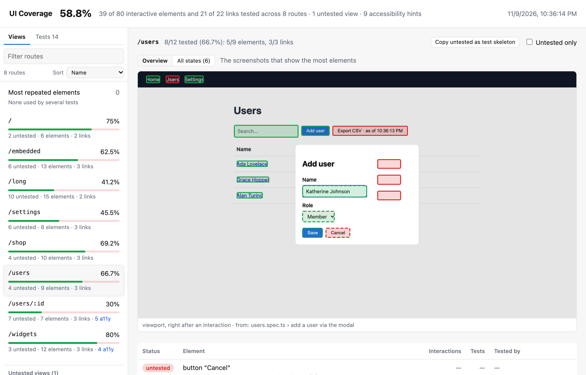

# What is UI coverage?

playwright-ui-coverage tells you which parts of your user interface your Playwright end-to-end tests actually use. After a test run you get an HTML report with a screenshot of every page your tests visited, each button, link and input outlined in green (a test used it) or red (no test did), a coverage percentage per page, and the list of tests that touched each element.

## Why measure the UI, not the code

Code coverage answers "which lines of code ran?". In an end-to-end test that's a weak signal: loading a page runs most of its code, whether or not a test clicks anything on it. A settings page can show 90% line coverage while no test ever changes a setting.

UI coverage answers a question closer to what an E2E suite is for: **which controls a user can see did a test actually operate?** It counts the things a user can interact with (buttons, links, form fields, tabs, menu items, anything focusable) and marks each one tested only when a test clicked it, typed into it, submitted it, dragged it, or (for links) reached the page it leads to.

| | Code coverage | UI coverage |
|---|---|---|
| Unit | lines, branches, functions | interactive elements and links, per page |
| "Covered" means | the code ran | a test interacted with the element, or visited the page a link goes to |
| Rendering a page | covers most of its code | covers nothing until a test uses a control |
| Output | source files with highlighted lines | screenshots of your app with highlighted controls |
| Setup | often an instrumented build or source maps | one import in the Playwright config; nothing changes in your app |

The two are complementary: code coverage finds logic no test reaches, UI coverage finds features no test exercises.

## What you get

- **Every page your tests visit, with each interactive element marked.** Dynamic URL segments are grouped into views (`/users/1`, `/users/2` → `/users/:id`). See [Reading the report](./reading-the-report.md).
- **The gaps, with the code to close them.** Each untested element has a ready-to-paste Playwright line, and each view a test skeleton. See [Suggested locators and accessibility hints](./locators-and-accessibility.md).
- **Every state, every step.** Step through each state a page reached, or replay a single test action by action, with the Playwright call, its line in the spec and a screenshot of the element it acted on. See [Step through every state](./reading-the-report.md#step-through-every-state) and [Walk through a test](./reading-the-report.md#walk-through-a-test).
- **Links counted by where they go.** A link is tested when a test reached its destination, by any path, and pages no test reached at all are listed as untested views. See [Links and untested views](./links.md).
- **CI gates.** Thresholds per view, a baseline that fails only on new untested elements, and a comparison with `main` for PR comments. See [CI](../ci/thresholds.md).
- **A machine-readable `coverage.json`**, versioned and with a JSON Schema. See [coverage.json](../coverage-json.md).

## How it fits into Playwright

The library records while your tests run and adds a reporter that builds the report afterwards:

- **Recording** runs in every browser context your tests create, either from one import in `playwright.config.ts` (register mode) or as a fixture you merge into your own `test` (fixture mode). It adds no steps to your HTML report or trace.
- **The reporter** (`playwright-ui-coverage/reporter`) merges the data from all workers and writes `ui-coverage-report/`. It works with retries, sharding and `merge-reports`, and with component tests.
- **Rules are applied at report time**, so you can change filters, views and identity rules and rebuild the report from the stored data without running the tests again. See [How it works](./how-it-works.md).

Ready? Continue with [Getting started](./getting-started.md).

> [!NOTE]
> Status: early development (0.x). APIs may change. Supports `@playwright/test` 1.50 or later, see [Compatibility](../reference/compatibility.md).
