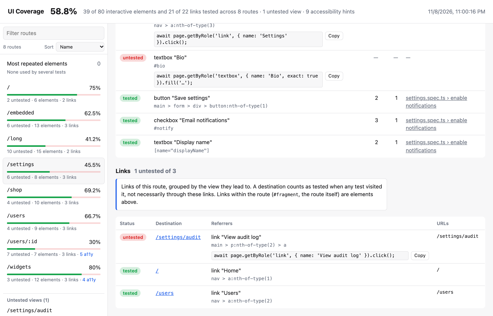

# Links and untested views

This page explains how links are counted (by where they go, not by clicks), how that affects the coverage score, and how to find pages no test reaches at all.

## Link units

A link matters because of **where it goes**, so links are counted by destination rather than by clicks:

- **Link units.** Each `<a href>` (and `<area href>`) is resolved (against `<base>` too) and mapped to a view by the same function as page URLs ([`views`, `viewFilters`](./views.md), then `normalizeUrl`); links to URLs `viewFilters` exclude are dropped. The links of a view that go to the same other view are **one unit**: on `/users`, the three user rows (`/users/1`, `/users/2`, `/users/3`) are one link to `/users/:id`, and the nav "Home" link and a "Back home" button-link are one link to `/`.
- **Tested** when any counted test visited the destination view, by any path (a `goto`, a redirect, another link), not necessarily through that link. "Counted" is the same as for interactions: the last passing attempt of each test, see [Retries and failed tests](./retries.md).
- **No double counting.** An `<a>` that belongs to a link unit is not also an interactive element. Its clicks are still recorded (shown with the link) but don't change coverage.

## Links that stay elements

These links are counted as interactive elements, tested when clicked:

- links within the same view: `#section`, `#`, a link to the page itself or to another page of the same view (like `/users/2` on `/users/:id`);
- `javascript:` and empty hrefs;
- links inside iframes (they navigate the frame);
- every link in [component tests](./component-testing.md).

`tel:`, `mailto:` and `sms:` links never count.

**External links** (to an origin no test visited) are interactive elements by default. `links: { external: 'ignore' }` leaves them out entirely. `links: false` turns link units off: every link is an element again.

```ts
// ui-coverage.config.ts
import { defineUiCoverageConfig } from 'playwright-ui-coverage/config';

export default defineUiCoverageConfig({
  links: { external: 'ignore' },  // default: {} (external links are elements); false: no link units
});
```

## Untested views

Destination views that no test visited at all appear separately:

- in the HTML report's sidebar ("Untested views", with the routes and links that point to them and the URLs);
- in `coverage.json` (`untestedViews`, with `referrers`);
- in the console (`1 untested view(s), only linked to: /settings/audit`).

Each view's page in the report has a **Links** table: destination view, *Referrers* (the `<a>` elements, with a suggested `page.getByRole('link', { name })…click()` line for untested ones) and *URLs*.



## The denominator

Coverage is (tested elements + tested link units) / (elements + link units), overall and per view, and that is what [thresholds](../ci/thresholds.md), the [baseline](../ci/baseline.md) and [`compare`](../ci/compare.md) use.

Compared with counting `<a>` elements by clicks, it usually goes up (navigation is commonly covered by visiting pages), and a view's numbers include its outgoing links.

> [!WARNING] Upgrading from a version without link units
> A baseline written before link units lists `<a>` elements as untested elements: they show as resolved (`removed`) and the link units as new gaps. Run `npx playwright-ui-coverage baseline update` once after upgrading.

See also: [coverage.json: what is counted](../coverage-json.md#what-is-counted-the-denominator).
