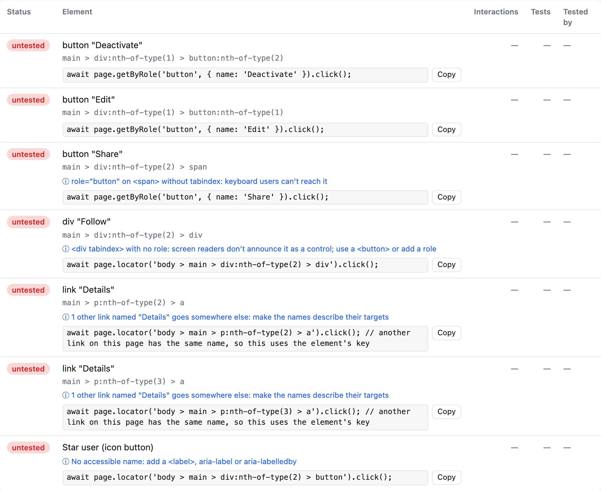

# Suggested locators and accessibility hints

This page explains the ready-to-paste Playwright line the report suggests for each untested element, the test skeleton per view, and the informational accessibility hints.



## Suggested locators

For every element, `coverage.json` has a `suggestedLocator`: one line of Playwright code that interacts with it. The report shows it (with a *Copy* button) for untested elements. It's built from the recorded data, deterministically, picking the first that applies:

1. `page.getByTestId('…')` if the element has the test id attribute. That's `use.testIdAttribute` from your Playwright config (or the reporter's `testIdAttribute` option), default `data-testid`. An attribute that doesn't start with `data-` is only recorded if it's in `significantAttributes`.
2. If the accessible name changed between runs or instances (the label shows `(+N variants)`), or another element with the same role has the same name on this view: `page.locator('<key>')`, the element's key as a CSS selector.
3. `page.getByRole(role, { name })`. Names from attributes and `<label>`s match exactly (`exact: true`); names from text content match like Playwright's default (case-insensitive substring), or as `/^…$/i` when that would also match a longer name on the view ("Save" and "Save draft").
4. `page.getByLabel(…)`, `page.getByPlaceholder(…)`, `page.getByTitle(…)`, `page.getByText(…)` when the name came from there and there's no usable role (a placeholder or title as the only name always uses these).
5. `page.locator('<key>')` otherwise. Positional keys get a `body > ` prefix.

Elements inside iframes get the same locator, starting from `page.frameLocator('<frame key>')` (once per nested frame).

The action follows the element: `click()` for buttons and links, `fill('…')` for text fields (with a sample value for `email`, `number`, `date`… inputs), `check()` for checkboxes, radios and switches, `selectOption('…')` for `<select>`, `setInputFiles('path/to/file')` for file inputs. Repeated elements (`×3`) get `.first()` and a comment on how to narrow it.

Untested [links](./links.md) get a `page.getByRole('link', { name })…click()` line in the Links table.

### Test skeleton

*Copy untested as test skeleton* produces (shortened):

```ts
test('covers untested elements on /settings', async ({ page }) => {
  await page.goto('/settings');
  // TODO: a line that navigates away (link, submit) ends this page state: split into more tests or goto() again.
  await page.getByTestId('delete-account').click();
  // TODO: assert the result
  await page.getByRole('textbox', { name: 'Bio', exact: true }).fill('…');
  // TODO: assert the result
});
```

If the browser blocks clipboard access (some do for `file://` pages), the text opens in a dialog, selected, to copy by hand.

### Limits

Suggestions are a starting point. Elements inside a closed dialog or menu need the steps that open it first, and a name with per-run text (a timestamp, a counter) that a run saw only once can't be detected as changing.

## Accessibility hints

Informational only: they don't change the coverage score or fail a run. The report shows them in blue under the element, with a count per view; `coverage.json` has `a11yHints: [{ rule, message }]` on elements that have any, and an `a11yHintsCount` per view and in total. The console summary prints the count (`9 accessibility hint(s), informational`).

| Rule | When |
|---|---|
| `no-name` | The control has no accessible name: no `<label>`, `aria-label(ledby)`, `title`, `alt` or (for buttons and links) text. A `name` attribute or a `<select>`'s options don't count. |
| `placeholder-only` | A field is named only by its placeholder. |
| `duplicate-name` | Links on the same view with the same name (case-insensitive) but different `href`s, e.g. several "Read more". |
| `not-focusable` | An ARIA role on an element that isn't focusable (`<div role="button">` without `tabindex`). |
| `no-role` | A plain element counted as interactive because of its `tabindex` or `data-uicov-interactive="include"`, with no role: screen readers don't announce it as a control. |

What it can't see: elements that are clickable only through a JS handler and have no role, `tabindex` or `data-uicov-interactive` (they aren't recorded at all), instances that share a key (only one instance's `href` is recorded, so a "View" link on every table row isn't compared), and names the browser computes differently from the tracker's approximation. For a full audit, use a dedicated accessibility testing tool such as axe.

## What the suggestions are built from

Each element's `role`, accessible `name` and `nameFrom` are recorded, and `coverage.json` lists them with the element's identifying attributes (`attrs`: `id`, `name`, `role`, `type`, `aria-label`, `href`, `tabindex`, `contenteditable`, `data-*` and your `significantAttributes`). See [coverage.json](../coverage-json.md#viewselements-elementcoverage).
