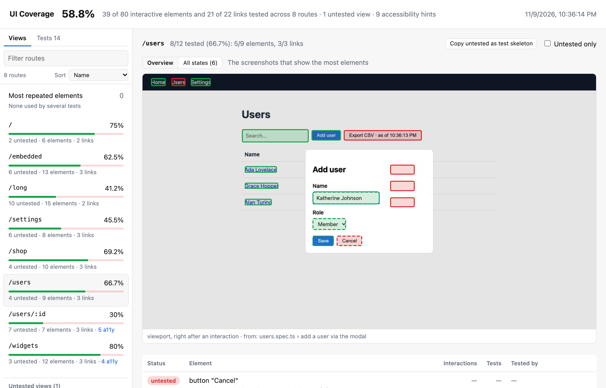
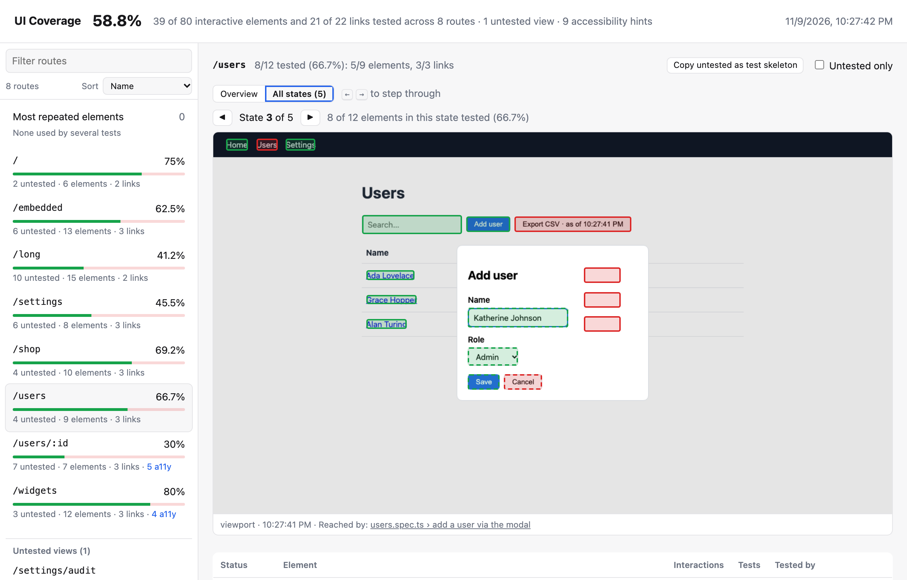
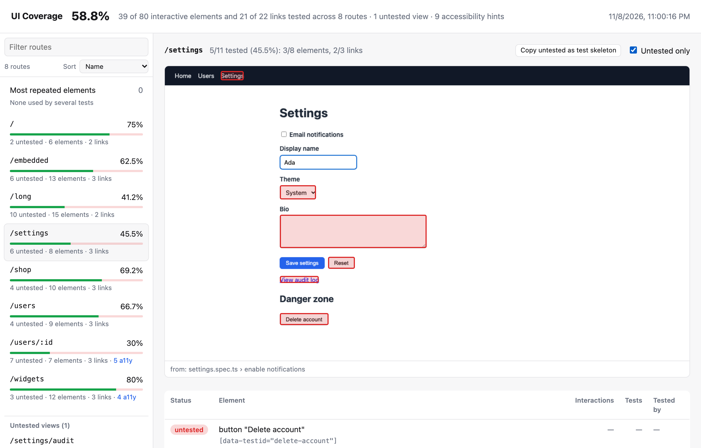
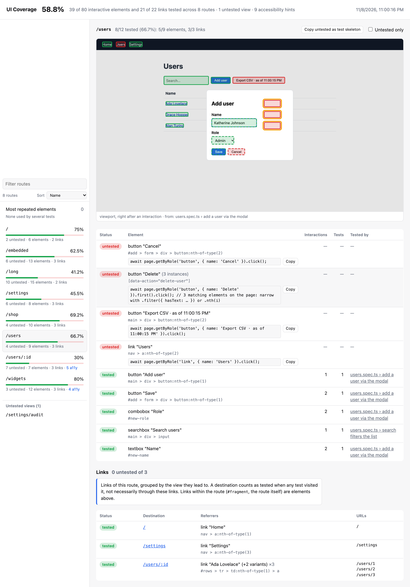
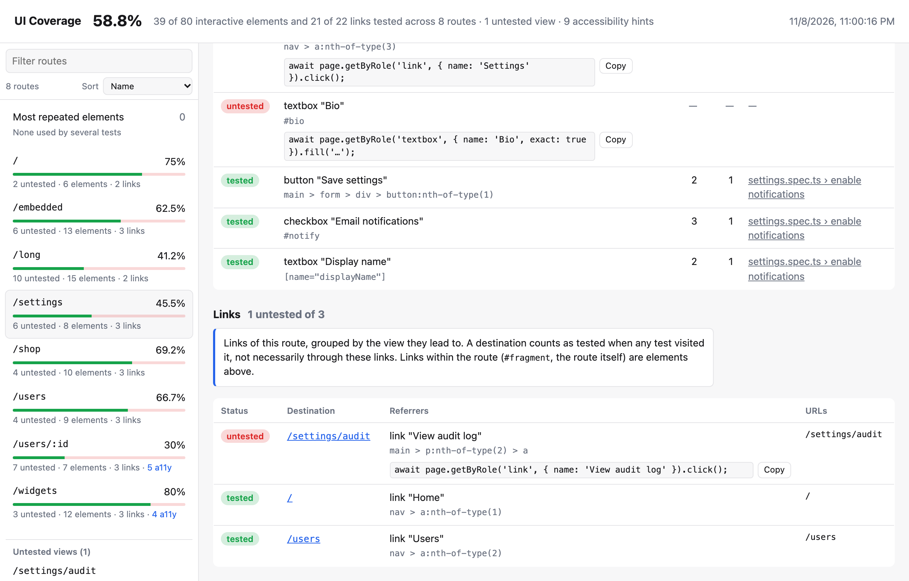
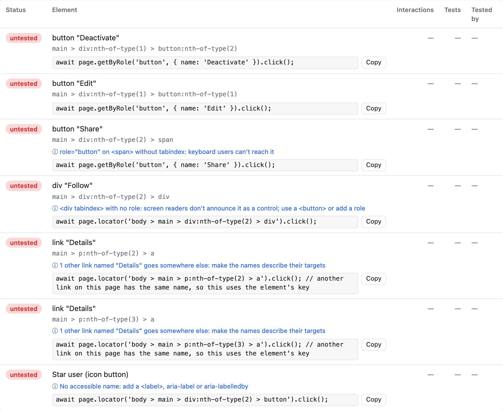
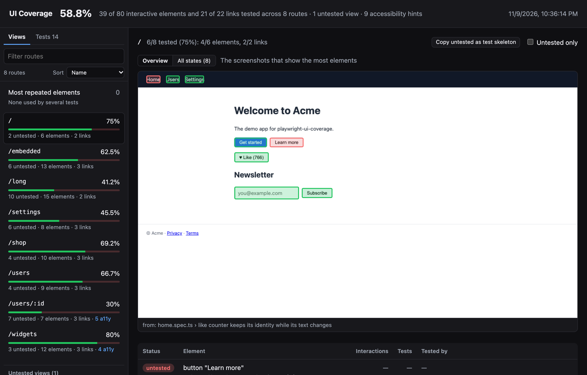

# Reading the report

This page walks through the HTML report (`ui-coverage-report/index.html`): what the sidebar, screenshots and tables show, and how to use them to find and close gaps.

## Views and coverage

The sidebar lists every **view** (a page of your app) with its coverage. Dynamic URL segments are grouped automatically (`/users/1`, `/users/2` → `/users/:id`); [Views](./views.md) explains how to name views yourself.

Each view shows up to three screenshots (`maxScreenshotsPerRoute`), chosen to show the most elements, with every interactive element outlined:

- **green**: a test interacted with it;
- **red**: no test did;
- **amber** (*failing tests only*): only tests that never passed touched it. It counts as untested, see [Retries and failed tests](./retries.md).

Boxes of `position: fixed` and `sticky` elements are drawn dashed, see [Screenshots](./screenshots.md#fixed-and-sticky-elements). Screenshots of short-lived states (a modal a test opened and closed quickly) are captioned "viewport, right after an interaction".

## Step through every state

The three screenshots are the overview. **All states** goes through every screenshot taken on the view, from every test, in the order the tests reached them: `◀ State n of N ▶`, or the <kbd>←</kbd> and <kbd>→</kbd> keys. Each state shows:

- the screenshot with the usual green and red boxes;
- its own coverage: how many of the elements in it are tested;
- **Reached by**: the tests (and retries) that produced it, each linking to the test and its trace in Playwright's HTML report, as under "Tested by". The same screen reached by several tests is one state.

Without the recording option [`steps`](../reference/recording-options.md#steps), the states are the screenshots the recorder takes anyway (when new elements appear). With `steps: 'on'`, there's a screenshot after every step of every test, so you can follow what a page went through. The address bar keeps the state (`#%2Fusers&state=3`), so you can link to it.

## Walk through a test

With [`steps: 'on'`](../reference/recording-options.md#steps), the **Tests** tab in the sidebar lists every test run, with its status and number of steps; filter it by name like the views. Select one to go through what it did, `◀ Step n of N ▶` (or <kbd>←</kbd> and <kbd>→</kbd>):

- the action and the element (`click button "Save"`), the Playwright call and where it is in the test (`locator.click getByRole('button', { name: 'Save' })` at `users.spec.ts:15:52`), when they were recorded;
- the view, linked to the state in [All states](#step-through-every-state), and the URL;
- the screenshot, with the element the step acted on outlined in blue and the other boxes green or red as everywhere else. **Before** shows the page the step acted on, **After** the page right after it; by default you see Before when it shows the element, After otherwise;
- for a repeated element (a "Delete" button on every row, see [Element grouping](./element-grouping.md)), which one it was, so a step that hit the right button on the wrong record stands out:
  - the step says where it was: `click button "Delete" row 2 of 3 · #user-42`. That's its row in a table or grid (`aria-rowindex` when the grid sets it; for a nested table, the outer row first: `row 2 of 3 · #order-7 › row 1`), or else the repeated item it's in (`item 2 of 3`: a card or list item, or the element itself among the others of its `data-uicov-group`). Identities are shown when they name one record, which means they have digits (`#user-42`, `[data-testid="delete-42"]`); one that's the same on every item (`[data-testid="todo-item"]`) isn't. A `<tr>`'s position counts the rendered rows of its `<tbody>`, header, spacer and detail rows included, and is left out when the table has several `<tbody>`; a `role="row"` gets a position only from `aria-rowindex`. Elements seen only once at a time (a field and its label) get no hint;
  - in **Before**, only that instance is outlined when its row, its item or the element itself has an identity that names its record, and the screenshot was taken right before the step. Otherwise every instance is, as in **After**: a re-sort, a recycled row or a delete that lands late can put another record in its place. Give rows an id or test id per record (`data-testid="user-42"`) to get the exact outline;
- every step of the test as a compact list (`1 load /users · 2 click button "Add user" · 3 input textbox "Name" · …`), to jump to one.

Each test run has its own walkthrough: a flaky test that failed once and passed on retry is listed twice, the failed run marked *failed* (and the run whose interactions didn't count marked *not counted*, see [Retries and failed tests](./retries.md)). Under "Tested by", a **step n** link next to each test opens the step that acted on that element, and in All states each test under "Reached by" links to its steps. The walkthrough also links to the test's entry in Playwright's HTML report and its trace.

Each test's steps are loaded only when you open it (from `steps/` next to `index.html`), so the report stays quick with many tests.

## Find what's missing

Turn on **Untested only** to hide everything that's already covered:

## See where each element is, and which tests cover it

Below the screenshots, the element table lists each element with its status, label and the tests that covered it ("Tested by"). Hover a row to highlight that element on the screenshot; click an element's box on the screenshot to jump to its row.

Repeated elements, such as a "Delete" button on every row, are grouped into one entry, `label (N instances)`, see [Element grouping](./element-grouping.md):

The tooltip of the *tested* label and of the **Interactions** cell shows the interactions that counted, by type (`click: 3, input: 1`).

## Links and untested views

Each view also has a **Links** table: its links grouped by destination view, with the `<a>` elements that point there (*Referrers*) and the URLs. Views that no test visited at all are listed under **Untested views** in the sidebar. See [Links and untested views](./links.md).

## Write the missing tests

Each untested element has a ready-to-paste Playwright line with a *Copy* button, and *Copy untested as test skeleton* gives you a whole test for the view. Elements also get small, informational **accessibility hints** (in blue), such as a control without an accessible name. See [Suggested locators and accessibility hints](./locators-and-accessibility.md).

## Jump to the test and its trace

With Playwright's HTML reporter configured, each test under "Tested by" links to its entry in the HTML report, and to its trace when one was recorded. See [Insights and the HTML report](./insights.md#links-to-the-html-report-and-traces).

## Spot repeated setup

The element table shows how many times each element was used (**Interactions**) and by how many tests (**Tests**); click either header to sort by it. **Most repeated elements** in the sidebar lists the elements used by the most tests across the report, such as a login form that every test fills in first. See [Insights](./insights.md#most-repeated-elements).

## Large suites

Filter views by name (press `/`), and sort them by name, lowest coverage or most untested elements. Screenshots load lazily. A synthetic report with 300 routes × 80 elements opens in about 0.1 s, and switching routes takes a few milliseconds (`npm run perf` in this repository measures it).

## Dark mode

The report follows your system's light or dark setting:

## Next to the report

The report folder also has:

- `coverage.json`: the same results, machine-readable, for CI gates and dashboards. See [coverage.json](../coverage-json.md).
- `data/`: the raw recordings and every screenshot, used to [rebuild the report](../reference/cli.md#report) with other rules.
